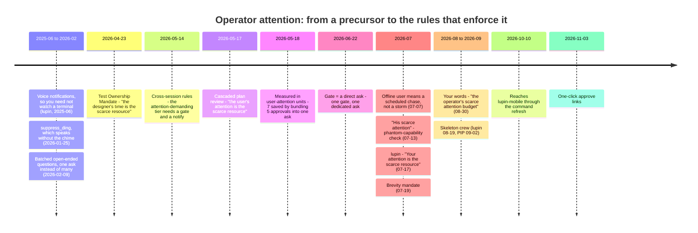

# When "Protect the Operator's Attention" Began: A Timeline

**Asked by**: Rick, by voice, 2026-11-04 · **Written by**: María · **Status**: explainer. Rick chose docs/explainer as its home on 2026-11-07.
**Repos searched**: planning-is-prompting, lupin, lupin-mobile (git history of every `.md` file, the history archives), plus every Claude Code session transcript on this machine.

## The Short Answer

- **First written down as a principle**: **2026-05-17**, in the design of the cascaded plan review (planning-is-prompting `e9e3416`): *"The user's attention is the scarce resource. Token cost is bounded and cheap. The point of this design is to spend the abundant currency (compute, inter-session DM traffic) to save the scarce one (user attention)."*
- **First put into a workflow**: **2026-05-14**, three days earlier. The cross-session communication rules (`29c7757`, Session 86) split every peer action into three tiers. The third, "attention-demanding", is the only one that needs a gate, and entering it requires a `notify()` to you.
- **The earliest root**: **2026-04-23** (`365b144`, Session 78), the Test Ownership Mandate: *"The designer's time is the scarce resource."* At that point it was about your **time**, not yet your **attention**.
- **First time your own words are on record**: **2026-08-30**, in a voice message: *"…with respect to me the operator's scarce attention budget."*

⚠️ **One limit on the evidence**: session transcripts on this machine go back only to **2026-08-06**. Anything you said by voice before then survives only where a session wrote it into a commit or a history entry. So "first on record" for your own words means first since August 6, not first ever.

## Timeline

## Phase by Phase

### 0. The precursors (2025-06 → 2026-02): the mechanisms came before the idea

Claude Code notifications already appear in lupin's first commit (2025-06-28). The premise was that you do not have to sit and watch a terminal. Two features later took more of the load off:

| Date | What | Where |
|---|---|---|
| 2026-01-25 | `suppress_ding`, which speaks a message without the alert chime | lupin `32d3d6f59`, PIP `2737bf0` |
| 2026-02-09 | `ask_open_ended_batch()`, which asks several questions as one | lupin `3cfdf8f03`, PIP `abe6ae5` |

None of these names attention as the thing being protected. They are conveniences that the idea later explained.

### 1. Your time (2026-04-23)

The Test Ownership Mandate (`365b144`, Session 78) puts testing on Claude: *"The designer's time is the scarce resource. Manual QA by the human is the anti-pattern this mandate exists to prevent."* It is still in the global CLAUDE.md today, along with *"there is not enough time in the world for the human to manually test anything."* The scarce thing here is your **hours**, not yet your **focus**.

### 2. Your attention, as a gate (2026-05-14)

In Session 86 the cross-session communication rules (`workflow/cross-session-communication.md`, commit `29c7757`) came out of a question walked with you about autonomy thresholds. They sort what a session may do on its own:

| Tier | Example | Gate |
|---|---|---|
| 1. Read | `commons_who`, `commons_read` | Always allowed |
| 2. Self-disclosure | `commons_post` to presence | Allowed |
| 3. **Attention-demanding** | `commons_ask_*`, contested claims | **Needs a trigger and a `notify()` to you** |

This is the first place a workflow treats a demand on attention as a cost that needs permission.

### 3. Your attention, as the design goal (2026-05-17 → 05-19)

The cascaded plan review (`src/rnd/2026.05.17-cascaded-plan-review-pipeline.md`, `e9e3416`, Session 91) was built because the serial `/plan-review` made you answer every finding. The design doc calls that *"the attention-killer pattern Mr. Rick was escaping"*: for a 2-section plan it meant about 10 to 30 decisions per section. The cascade used a manager to filter findings, so only foundational ones reached you:

| Run | Findings | Reached you |
|---|---|---|
| Run 2 (05-18) | 21 | 2 |
| Run 3 (05-19) | 75 questions in | 2 (about 37× fewer) |

On **05-18** (`6c8b7b1`) the idea got its unit of measure: bundling 5 approvals into one ask *"saved ~7 user-attention units."* That same evening you asked to apply the cascade to plan **authoring** as well, because a stalled plan had *"the EXACT serialized-Q-decision attention-killer pattern."* That request led to `/plan-authoring-cascaded`. lupin picked up the same language on the same day (`d7a443c6c`).

### 4. From a principle to rules (2026-06 → 2026-07)

| Date | Rule | What it protects you from |
|---|---|---|
| 2026-06-22 | **Gate = a direct ask** (`c045cf5`) | Approvals buried inside status messages |
| 2026-07-07 | **Offline user ⇒ a scheduled chase** (`1caff02`) | Re-asking every few minutes while you are away |
| 2026-07-13 | **The phantom-capability check** (`175633d`): *"spends his scarce attention ratifying a decision built on something that does not exist"* | Recommendations that rest on things that do not exist |
| 2026-07-17 | lupin: *"Your attention is the scarce resource… we execute it"* (`eaef65375`) | Hand-editing tables yourself |
| 2026-07-19 | **Brevity mandate**, KISS and 3LoL (PIP `78aa32d`, lupin `ac661631c`) | Long messages, in text and in speech |

### 5. Your own words, and the operating modes (2026-08 → 2026-09)

- **08-25**: a manager briefing a worker: *"María and I are managing his attention tonight and parallel asks are a storm."* The fleet now handles your attention as its job.
- **08-30**: the first time your own words are on record. You asked what cascading had shown *"with respect to me the operator's scarce attention budget."*
- **09-04**, in lupin-mobile: blocking asks from managers *"make a request of my attention while I'm looking at your app on the emulator."*
- **Skeleton crew** (lupin 08-19, PIP 09-02) made "how much of you is available" into a setting rather than something each session has to guess.

### 6. Spreading and lowering the cost per ask (2026-10 → 2026-11)

- **10-10**: lupin-mobile receives the idea when its commands are refreshed (`0d38a7e`). It never developed the idea itself; it got it through the shared commands.
- **11-03**: one-click approve links. An approval drops from reading plus typing to a single click, and 📋 shows the content first.

## What the Timeline Shows

1. **The idea moved from your hours to your focus.** In April the scarce thing was your time for testing. By May it was your attention, measured in units and filtered by a manager.
2. **It was a gate before it was a principle.** The rule that attention-demanding asks need a trigger came three days before the sentence that named attention as the scarce resource.
3. **lupin and PIP grew it together; lupin-mobile inherited it.** Most of the wording started in PIP and reached lupin within a day. lupin-mobile got it in one step on 10-10.

## Sources

| Claim | Receipt |
|---|---|
| First commits per phrase | `git log --all -i --reverse -S"<phrase>" -- '*.md'` in each repo |
| Session 86 tiers | `history/2026-02-02-to-05-20-history.md` §2026.05.14 |
| Cascade numbers | `src/rnd/2026.05.17-cascaded-plan-review-pipeline.md` §10.14–10.15 |
| Your quotes | session transcripts in `~/.claude/projects/` (2026-08-06 onward) |
