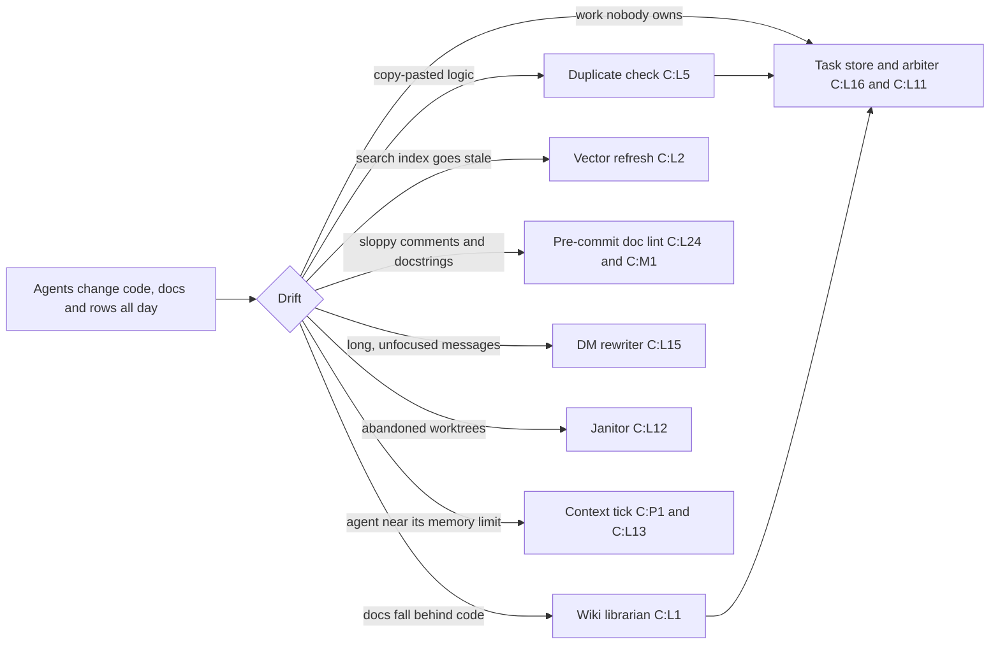

# A Repo That Never Sits Still: Dynamic Equilibrium in an AI-Written Codebase

**Asked by**: Rick, by voice, 2026-11-07 (row `1740292a`) · **Written by**: John, for María · **Status**: draft explainer for a reader outside the fleet; it may become the basis for an article.
**Evidence**: every claim about the running system cites the process catalog, `src/rnd/2026.11.07-live-repo-process-catalog.md` (committed as `42a377d`), by entry number, written **C:P1** to **C:P15** (planning-is-prompting), **C:L1** to **C:L30** (lupin) and **C:M1** to **C:M3** (lupin-mobile), or by section (**C §5** is its gaps table). Anything else cites its own source. Readings were taken on 2026-11-07 between 13:20 and 14:10 EST.

## The Short Version

- Code used to be written, tested and left alone until the next release. In these three repositories it is changed by many agents every hour, and it stays usable only because **48 separate processes keep checking it and correcting it** (C §1).
- That is a **dynamic equilibrium**: nothing is still, and the system holds together because every drift is met by something that pushes back.
- The balance is not guaranteed. On the day of the survey, four of those processes were broken or missing, and one of them (the duplicate check) was filing work faster than anyone could clear it (C §5, gaps 1 to 4, 11).
- Rick no longer reads the source. He listens to explainers rendered as podcasts, with expert criticism built in. That makes the *explainer*, not the code, the thing he actually looks at, and it raises questions about how a live repository should be organized and shown (last section).

## 1. The shift: from a thing that sits to a thing that is kept

Rick's thesis, in his own words from 2026-11-07:

> "We have created a system of dynamic equilibrium in which we are continually in a state of flux. This code base is never static like code used to be before we had AI generated code, and as such we need to think differently about how we are organizing, how we interact with, and how we visualize the contents of a functioning, almost metaphorically live repo or collections of repos."

A useful picture is a boat that takes on water and bails it at the same time. No one ever sees the boat dry. What matters is that the bailing keeps up. The survey's job was to list every bucket.

It found what a reader would expect (a commit check, a test gate) and a good deal they would not: timers that run at minute 17 past ten every morning, loops inside a background service that wake every sixty seconds, and rules that fire on every single tool call an agent makes. The three repositories together count 48 such processes (C §1). The table in C §2 gives, for each, what it reads, what it changes, what starts it and whether it was running on the day.

## 2. What is being kept in balance

The processes group naturally by the drift each one corrects. The groups below are mine; the entry numbers show where each fact lives.

### Code against duplication

The **daily duplicate check** compares what changed on the main branch against everything already in the tree and files a row for each function that repeats an existing one (C:L5). On 2026-11-06 it ran by hand, judged 304 functions with a 300-call cap, and filed 45 rows (row `c7deca58`; result file `2026-11-06-190659-hand.json`).

### Documentation against code

The **wiki librarian** checks the code wiki against the code index each morning and files a row per out-of-date package (C:L1). It also checks the lupin-mobile wiki.

### The search index against the code

The **vector refresh** rebuilds the index that reuse lookups search. On 2026-11-07 it built 13,218 rows in about 135 seconds (C:L2). The librarian and the shadow audit read what it builds (C:L3).

### Comments and docstrings against style

Every commit in lupin passes through a **doc-lint gate** that checks docstrings and `#` comments for banners, shouting and rule breaks, and refuses the commit on a finding (C:L24). lupin-mobile has its own commit gate for Dart and markdown (C:M1).

### Messages against the brevity rules

When an agent sends another a direct message that runs long, the **DM rewriter** reduces it to a headline, two supporting sentences and a path. If anything goes wrong it delivers the original instead (C:L15). In the ten minutes before the survey it refused a rewrite for inventing a name that was not in the original.

### Work against the board

Workers read their assignments from the **task store**, a database of rows with owners and statuses (C:L16). Around it, the **fleet arbiter** wakes every sixty seconds to look for stalled seats and poke them (C:L11), and a **worktree janitor** inside the same service retires abandoned working copies (C:L12; on 2026-11-07 at 12:11 it deleted two rescue branches).

### Agents against their own memory limit

A **context tick** runs every ten minutes, reads how full each agent's memory is and tells its manager before it overflows (C:P1, C:L13).

Between them, these processes touch the same few things: the task store, the vector set, the worktrees. C §3 maps who feeds whom and where two of them act on the same object.

## 3. Three episodes

**The 6 November duplicate check.** One hand-run produced 45 rows. They were titled "Duplicate: <name> in <file> repeats N existing definition(s)", created by `duplicate-check-daily`, owned by "manager on duty", and left waiting for approval in the holding area. Rick noticed that the creator and assignee fields held names that were not people. Row `c7deca58` records the defect: the check files one row per finding, and its owner is a role label because the job runs with no session behind it.

**The librarian that stopped quietly.** The wiki librarian's log ends every run since at least 2026-11-02 with "tick could not read rows to export: status 200". HTTP 200 means success, so the code treats a good answer as an error (row `791bf720`). Its state file shows the last clean run on **2026-10-20** (C:L1). Nothing alarmed, because the tick is a *quiet* job by design.

**The lights-out ruling.** The duplicate check was first scheduled to run at the end of the day, as part of closing the session. On 2026-11-07 Rick objected: "I fundamentally disagree with running work after last call end of session and lights out, because at that point lights out means I want to turn the server off for the day." The check moved to a morning cron every day the server is up (row `350d43c8`). That cron is **planned, not installed** (C:L5).

## 4. Where the balance fails

The survey found three kinds of failure. Each is a general risk of this style of system, not a one-off.

**A loop that files more than it clears.** The duplicate check was given a cap of 300 judge calls a run, but about 560 changed functions arrive each day. The 6 November window carried 2,124 undecided functions forward, and nothing ran it again, so the backlog grows (row `477df9a2`; C §5, gap 1). Every filing step that is faster than its clearing step does this.

**Owners that are role labels.** A row owned by "manager on duty" or "wiki-librarian tick" has nobody who will see it. 45 duplicate rows and 5 librarian rows sat in the holding area under those labels (row `c7deca58`; C §5, gap 4). A board only works if every item has someone to look at it.

**Jobs that fight the operator's day, and checks that go silent.**
- The lights-out ruling above is the first kind.
- Of the second: the doc-parity tick and the git-hook watcher print nothing when clean, so a healthy run and a tick that never ran leave the same empty log (C:P3, C:L9; C §5, gap 12).
- The reuse-behaviour page fails every run from cron because the cron line lacks one configuration variable, and its log says "Nothing was made" (C:L4; C §5, gap 3).
- All three lupin-mobile GitHub workflows failed on 2026-11-04, and nothing on the host reads CI results (C:M3; C §5, gap 11).
- Four one-shot cron lines from September are still in the crontab and will fire again next year (C §5, gap 6).

A detail worth keeping: the survey was assembled by reading logs and configuration, never by running the checks. In a system that changes this fast, an observer that disturbs it would measure itself.

## 5. How Rick sees it now

Rick's addendum, on how he now looks at the code:

> "I'm no longer looking at the source code. I'm actually depending on you and others to write explainers, which then get rendered as podcasts, so I can hear a global view or an explanation of how something is designed or working, and then I also hear criticism from the experts in the podcast."

This is the second half of the same shift. If agents write the code and processes keep it in balance, the operator's job moves up a level, to judging the *account* of the system rather than the system itself. Two earlier pieces of work already point that way:

- The operator-attention timeline traces **"the scarce resource is the operator's attention"** from a testing mandate on 2026-04-23, through rules that gate every demand on attention on 2026-05-14, to one-click approve links on 2026-11-03 (`docs/explainer/2026.11.04-operator-attention-timeline.md`).
- The brevity work shows a message being reshaped to fit attention before it reaches the operator (the KISS explainers, `docs/explainer/`), and the DM rewriter is the mechanical form of it (C:L15).

An explainer rendered as a podcast adds something source code cannot: other voices arguing with it. Rick describes hearing "criticism from the experts in the podcast." The catalog is a good example of what is missing without one. It is a table of 48 rows; the failures in it only became visible when someone read the logs and set them side by side.

## 6. Open questions for the next step

These are left as questions, on purpose.

1. **Organizing.** The processes live in three repositories, in cron, in hooks, in a background service and in written workflow steps (C §2). Is there one place that should list them, and who keeps that list correct? The duplicate-check cron is documented in `workflow/last-call.md` yet absent from the machine (C §5, gap 1).
2. **Interacting.** Which processes are allowed to file work, and which are allowed to close it? A loop that can only add rows will always lose to the inflow.
3. **Visualizing.** What does a live repository look like at a glance: a map of whose output feeds whose input (C §3), a day clock (C §4), a count of drift against correction? What would let Rick *see* the 2,124-function backlog without a survey?
4. **Quiet versus dead.** How should a check say "I ran and found nothing" differently from "I did not run"?
5. **Whose day.** What should the system be forbidden to do when the operator turns the server off?
6. **Observation without disturbance.** Can the system report on itself the way this survey did, from logs and configuration alone?

---

*Open item from row `1740292a`: Rick is to be offered a podcast rendering of this explainer.*
