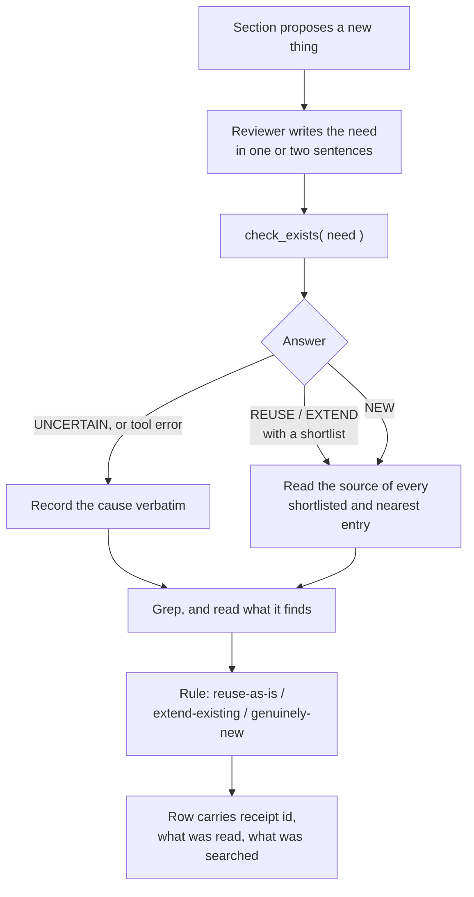
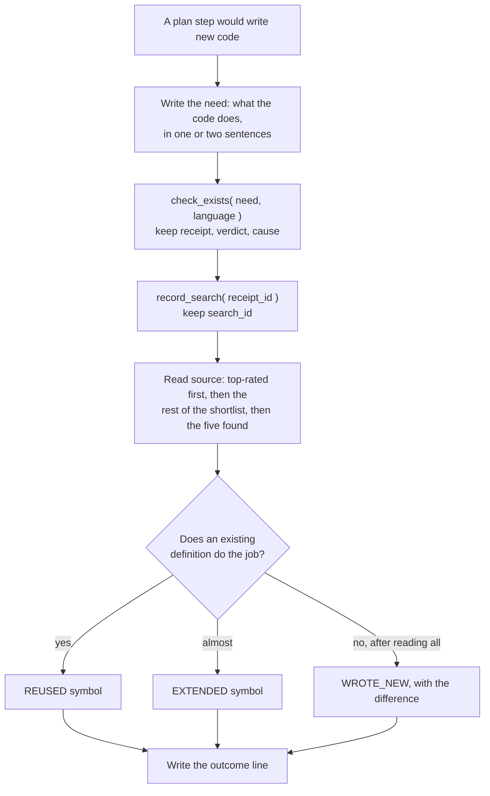

# Cascade reuse check through the code index — design for review

**Author**: María 🌸, 2026-10-01 · **Status**: proposal, nothing in `workflow/` changed · **For**: Rick

> **2026-11-02 addendum (§8)**: the plan-time check, revised after the Part 3 measurements. Asked for by Cheech for Rick (DM 17:20, row `3d11c8b3`). §3.4's `NEW` row and §5's first two gaps are out of date; §8.1 says what changed.

**Asked for** (Rick, voice, 2026-10-01): *"the reuse phase will now have a resource that it can call through MCP to see if similar functionality already exists, so that [there is] a fact based check that a reviewer can make on any given claim as to whether something new needs to be built, modified or reused."*

## 1. Summary

1. **The cascade can adopt the check today as a rule about evidence, but the tool cannot answer yet.** The three lookup tools are mounted and the index builds, but the part that asks Jev to compare a need against the index is a stub. Until lupin finishes it, every lookup returns "uncertain, read the source".
2. **The real gap in the cascade is that a "nothing like this exists" ruling carries no evidence at all.** The reviewer is told to grep, and nothing asks what was searched or what came back. The index check fixes that whether or not Jev is live, because every call returns a receipt id.
3. **The tool never decides.** It builds a shortlist. The reviewer rules after reading the source. That is lupin's own design, and this proposal keeps it.

## 2. What exists today

Read on 2026-10-01 at lupin `0c617d906`. Gathered by a read-only helper; the six rows marked ✔ I re-read myself.

| Fact | Where |
|---|---|
| ✔ Three lookup tools are mounted on the cosa-voice server: `check_exists( need )`, `fetch_similar( entry )`, `read_capability( names )`, plus `replay( receipt_id )` | lupin `src/lupin_mcp/cosa_voice_mcp.py` 5735–5816 |
| ✔ The live Jev call behind `check_exists` is not built: `LiveJevTransport.post` raises `NotImplementedError( "live Jev transport is phase W-A" )` | lupin `src/lupin_mcp/reuse_tools.py` 210–217 |
| ✔ No key file for it exists, so a call today would answer `UNCERTAIN_READ_SOURCE` with cause `KEY_UNREADABLE` (inferred from the code; the tool was not called, since a call writes a receipt) | `src/conf/keys/` has no typesafe entry |
| ✔ The tools refuse any repository that is not lupin (`NOT_LUPIN_TREE`), lupin-mobile included, although the index builder can read Dart | `reuse_tools.py` 411 |
| ✔ `fetch_similar` takes the id of a symbol **already in the index**. It cannot be asked about something a plan only proposes (`UNKNOWN_ENTRY`) | `reuse_tools.py` 504–509 |
| ✔ `read_capability` returns `NOT_FOUND` for every name: no capability pages are written yet | lupin `src/docs/wiki/capabilities/` does not exist |
| The index holds **public symbols only**, each as signature plus the first line of its docstring. No function bodies. Tests, `src/rnd`, private and nested helpers are not in it | lupin `src/cosa/repo/symindex/`, `README-symindex.md` 24–29 |
| The index is rebuilt on demand when files on disk change. It sees one working tree: not other worktrees, not unwritten code | `build.py` 290–314 |
| Sam's merged Jev adapter is a **different job**: it judges whether a rewritten docstring still states a claim. It uses a different question type from the reuse sweep and reads its key from an environment variable; the reuse path expects a key file | lupin `src/cosa/repo/doc_lint/jev_transport.py`, `jev_judge.py` |
| No recall number exists for the reuse check. Lupin's plan says the tools stay advisory until Rick sets one | lupin plan 2, ruling E10 |

**What the cascade says today** (✔ re-read): reuse belongs to the Stage 1 Usability/Reuse reviewer. The mandate is "actively grep the codebase for prior art", one row per new thing, with a verdict of `reuse-as-is`, `extend-existing` or `genuinely-new`. A `genuinely-new` row needs only "no prior art found; explain WHY this is novel" (`workflow/plan-review-cascaded-personas.md` 220–231). No later stage re-checks it. None of the cascade files mention the lookup tools.

## 3. The proposal

### 3.1 Who and when

| Moment | Who | Tool |
|---|---|---|
| Writing the plan's reuse map | Plan author | `check_exists` per proposed new thing; receipts go in the map |
| Stage 1 of the cascade | Usability/Reuse reviewer | `check_exists` per "new thing" row, then reads source, then rules |
| A `reuse-as-is` or `genuinely-new` ruling is disputed | Counter-reviewer (charter already exists in `workflow/swe-team-roles.md`) | `replay` on the cited receipts, then reads what the reviewer dismissed |
| Reviewing code, not a plan | SWE Reviewer | `fetch_similar` per new definition in the diff. **Not usable in plan review**: it needs a symbol that already exists |

### 3.2 The check, per claimed-new thing



1. **Write the need** from the section's own words: what the new code would do, not what it would be called.
2. **Call `check_exists`** and keep the `receipt_id`, the verdict and, if uncertain, the cause.
3. **Read the source** of every entry on the shortlist and the nearest list. A `NEW` answer does not excuse this: the tool compares one-line descriptions, not behaviour.
4. **Grep anyway.** The index cannot see private helpers, tests, other repositories, another worktree's uncommitted work, or code whose docstring's first line does not describe it. Grep covers what the index is blind to; the index covers same-behaviour-different-name, which grep is blind to.
5. **Rule**, and write the row.

### 3.3 The evidence row

Replaces today's three-column table.

| New thing | Need sent | Receipt | Tool answer | Candidates read (file:line) | Grep: terms, roots, hits | Ruling | Why |
|---|---|---|---|---|---|---|---|

- **A `genuinely-new` ruling with an empty "Candidates read" or an empty "Grep" cell is unsupported**, and the manager classifies it as a finding against the review. This is the cascade's existing rule, *state what you ran, not what you considered*, applied to the one ruling that today needs no evidence.
- **The receipt proves a call happened; the row proves the reviewer used it.** A receipt beside a ruling that ignores the shortlist is a finding.

### 3.4 How the tool's words map to the cascade's

| Tool answer | Cascade ruling | Condition |
|---|---|---|
| `REUSE` | `reuse-as-is` | after reading the candidate |
| `EXTEND` | `extend-existing`, naming the symbol | after reading the candidate |
| `NEW` | `genuinely-new` | only after reading the shortlist and nearest entries, and the grep |
| `UNCERTAIN_READ_SOURCE` | none yet | the reviewer rules from source and grep alone, and says so |

### 3.5 When the tool cannot answer

This is the normal case today, so the rule has to be usable without it.

| Situation | What the reviewer records | What the reviewer does |
|---|---|---|
| `UNCERTAIN_READ_SOURCE` with a cause (`KEY_UNREADABLE`, `CALL_FAILED`, `INDEX_STALE`, …) | the cause, verbatim, and the receipt id | grep plus reading; the row says "index check gave no shortlist: `<cause>`" |
| `NOT_LUPIN_TREE` (any other repository) | that word | grep plus reading; this is every lupin-mobile and planning-is-prompting plan today |
| `REUSE_TOOLS_UNAVAILABLE`, or the tool is not mounted | the error text | grep plus reading |

**Never** write `genuinely-new` on the strength of an answer that was uncertain or absent. **Never** leave the Receipt cell blank without a reason in it: a blank reads as "did not try".

### 3.6 Advisory until a number exists

Lupin's ruling E10 keeps the tools advisory until a recall figure is measured and Rick sets a bar. This proposal follows it: the **receipt and the recorded search are required now**; the **tool's verdict carries no weight in a dispute** until E10 is ruled. When it is, one sentence in the persona file changes.

## 4. Where the text would land

All in this repository, none written yet.

| File | Change |
|---|---|
| `workflow/plan-review-cascaded-personas.md`, Persona 3 | the mandate, the evidence row, the mapping and the cannot-answer table (§3.2–3.5) |
| `workflow/plan-review.md` §4 | the same receipt requirement; lupin's plan 2 already says this section will require receipts, and it does not yet |
| `workflow/plan-authoring-cascaded.md`, reuse map and must-reuse list | each entry carries a receipt or the reason there is none |
| `workflow/plan-review-cascaded-input-spec.md` | a plan arriving for review states whether its reuse map was index-checked |
| `workflow/swe-team-roles.md` | Reviewer charter gains `fetch_similar` per new definition; the Counter-reviewer charter cites a `dispute-flow.mmd` that does not exist in lupin (the diagram is a block inside plan 2) and should point there |

## 5. What this depends on in lupin

None of it is this repository's to build. Listed because each one changes what the rule can honestly promise.

| Gap | Effect on the rule | Whose |
|---|---|---|
| The reuse sweep's live Jev call is a stub | No shortlist anywhere until built. Sam's merged transport reaches the same service but asks a different kind of question; whether it can be reused for the sweep is unverified | Cheech's crew |
| 🔴 **The exclusion list is not wired.** Rick approved sending signatures and first docstring lines to the service *"under an exclusion list he approves"*. The code accepts a list but production never passes one, and no config key for it was found | The day the live call is switched on, every public symbol is sent, including any module Rick meant to exclude. **This should block switching it on** | Cheech's crew, then Rick's approval of the list |
| The tools refuse non-lupin repositories | The check does nothing for lupin-mobile or this repository | Cheech's crew |
| Key location: plan says a key file, Sam's transport reads an environment variable | Two key paths for one service | Cheech's crew |
| Index written inside lupin's working tree; ruling B4 said the fleet data folder | Not a blocker; a divergence from a ruling | Cheech's crew |
| No gating flag exists in config | Nothing to flip when E10 is ruled | Cheech's crew |
| No capability pages | `read_capability` has nothing to return until the package sweep | plan 1 |

## 6. Decisions for Rick

| # | Decision | Recommendation | Why | The other way |
|---|---|---|---|---|
| 1 | Adopt the evidence row and the recorded-search requirement now, before the tool can answer? | **Yes** | It closes the "nothing exists" hole today with grep evidence alone, and reviewers build the habit before the tool matters | Wait for the live call: simpler rollout, but the hole stays open for weeks |
| 2 | Should a missing receipt block a section from closing? | **No, a finding the manager classifies** | The tool cannot answer yet, and blocking on it would stall every cascade | Blocking: stronger, appropriate once E10 is ruled |
| 3 | Who checks first, author or reviewer? | **Both: author fills the reuse map with receipts, reviewer re-checks the rows ruled new** | Receipts are cached per need, so the second look is cheap, and the reviewer writes the need independently | Reviewer only: less author work, but plans arrive unchecked |
| 4 | Hold the live Jev sweep until the exclusion list is wired and approved? | **Yes** | It was your condition for approving the send | Switch on first: faster, sends everything |
| 5 | Should the tools answer for lupin-mobile and this repository? | **Yes, as a lupin ticket** | Two of the three repositories get nothing from the check otherwise | Leave lupin-only: no work, grep-only reviews elsewhere |

## 7. Not established

- What the three tools actually return when called. Not called, because each call writes a receipt and a log line.
- Whether the sweep's question type is accepted by the service. The only code that makes a real call uses the other type.
- Cost and time per check at the current index size (lupin's wiki index page records 7,240 public symbols; the plan estimated minutes per question).
- Whether any seat's server writes receipts somewhere other than the default data folder.
- Recall. No number exists; nobody should trust a `NEW` until one does.

## 8. Addendum, 2026-11-02: the check moves before the plan decides to write code

**Asked for**: Cheech for Rick, DM 2026-11-02 17:20. Run the reuse check before any plan step decides to write new code, not only at diff review, and teach the reader how to read the answer. Lupin's review-time half is `.claude/skills/reuse-reviewer/SKILL.md`; this is the plan-time half.

**Verdict**: the change is three rules and one log line. Search every time, not only before ruling something new; treat every shortlist entry as a lead, not a match; never rule "new" on an uncertain answer; record what the plan then decided against the receipt.

### 8.1 What changed since §2 to §7

| Then (1 Oct) | Now | Source |
|---|---|---|
| `check_exists` could answer `NEW` | Retired. "Found nothing" is now `UNCERTAIN_READ_SOURCE`, cause `NO_MATCH`, and still names the nearest entries | Rick, 24 Oct; lupin `reuse-reviewer/SKILL.md`, "The three vocabularies" |
| Nothing searched beyond the index | `record_search( receipt_id )` searches the working tree for three to six terms and returns the five nearest definitions and a `search_id`. It makes no model call | lupin `src/lupin_mcp/cosa_voice_mcp.py` `record_search` |
| Live Jev call was a stub | Built and measured. But live lookups still run the old full scan, which hits the 9,000-call limit, so every recent live lookup answered `UNCERTAIN_READ_SOURCE` | Cheech's roadmap, "Where we are" |
| Exclusion list not wired | The review skill documents `EXCLUDED_SENSITIVE_CONTENT` and `EXCLUDED_PREFIX` refusals. I have not checked that the filter matches the list Rick approved | `reuse-reviewer/SKILL.md` step 2 |
| No recall number | 58 of 70 known answers found end to end: 10 never retrieved by the search, 2 retrieved and not read | lupin revised plan §15.3 (C2) |

`workflow/plan-review.md` §4 still carries the retired `NEW` row in its vocabulary table. That is a stale fact in a canonical file, fixed by this change.

### 8.2 What the measurements say about reading an answer

| Fact | Figure | What the reader does with it |
|---|---|---|
| The shortlist is mostly look-alikes | In 67 of 70 needs a wrong candidate scores at or above the 0.30 shortlist line; the median need has 7 of them, against at most one right answer. 24 needs fill the 10-slot cap | A shortlist entry is a lead. Read its source before naming it |
| The judge's score does not separate them | The best wrong candidate's median score is 0.95. At 0.30 the judge passes 94% of same-job pairs and 41% of not-same pairs (ranking score 0.682) | Never rule on a score. Two candidates at 0.97 and 0.95 are not "the first is better" |
| The top-rated candidate is usually the right one, when one exists | The known answer was top-rated in 50 of 60 needs | Read the top candidate first. Its rank is where to start reading, not a ruling |
| The search misses about one need in seven | 10 of 70 known answers never reached the candidate list | A short or empty shortlist is not "nothing exists". Nothing in the toolset reliably finds what the search missed (next row) |
| `record_search` does not catch those misses | Its five candidates held the known answer for 1 of the 10, searching on the need text alone with no terms of the agent's own (John's replay, zero model calls, index at lupin `c855c6211`) | Run it anyway: it is free. But add your own `extra_terms`, the identifier words you would expect in the code, and never treat its five as the last word |
| Every live answer today is uncertain | Until the roadmap's step 1a switches the search-first route on | The rule has to work with no shortlist at all. It does: source and the recorded search |

Sources: Chloé's Stage A table, lupin `io/write-ups/2026.11.02-part3-s20-read-chloe.md`; Stage C, `io/write-ups/2026.11.02-stage-c-results-chloe.md` via the Part 3 post-game; `record_search` replay, John, 2 Nov 17:34 (a scratch file on his seat, relayed by Cheech).

### 8.3 The plan-time check, per thing a plan step would build



1. **Write the need** in the plan's own words: what the code would do, not what it would be called.
2. **Call `check_exists( need, language )`.** Keep the receipt, the verdict and any cause. If the plan changes an existing symbol, also call `fetch_similar` on it; that tool takes only symbols already in the index.
3. **Call `record_search( receipt_id, extra_terms )` every time**, not only before ruling something new. It costs no model call. Pass three to six identifier words you would expect the existing code to use: on the need text alone it found 1 of the 10 answers the index missed (§8.2).
4. **Read source.** The top-rated candidate first, then the rest of the shortlist, then the five `record_search` returns.
5. **Decide**, and write the outcome line (§8.4).

**Reading rules**, written into each workflow that runs the check:

- A shortlisted candidate is a lead, not a match. Expect most of the shortlist to be look-alikes.
- `UNCERTAIN_READ_SOURCE` means "the checker does not know". It never means "nothing exists". Record the cause, read the nearest entries and the `record_search` five, and decide from source.
- No `WROTE_NEW` on a shortlist alone, a score alone, or an uncertain answer alone. It needs the candidates read and the search cited.
- If the tool refuses the repository (`NOT_LUPIN_TREE`) or is not installed, grep, read what grep finds, and write the reason where the receipt would go.

### 8.4 The outcome line

The roadmap's track 3a records what an agent did after each lookup. The plan text can start recording it now, in a shape a script can read later:

```text
REUSE-OUTCOME <receipt id> :: <search id> :: REUSED <symbol> | EXTENDED <symbol> | WROTE_NEW <difference> :: <plan path>#<step>
```

- The plan author writes it in the reuse map when the step is planned.
- The implementer confirms it or writes a second line when the code lands, so a plan that said `REUSED` and shipped new code shows both lines.
- A receipt with no outcome line is a lookup nobody acted on, which is the gap track 3a exists to close.

Whether the server should record the outcome itself (a tool call) is track 3a's design, Sam's. The text line works either way and gives 3a a backlog to ingest.

**Requirement: an outcome checker** (Rick, ruling decision 3, relayed by Cheech 17:31). A checker refuses any line that starts with `REUSE-OUTCOME` and does not match the format above. It also refuses a line whose receipt is not in the lookup log. This is how lupin's `src/lupin_mcp/reuse_exit_gate.py` already treats `RULING` lines. `WROTE_NEW` takes free text: there is no fixed list of reasons.

| Part | Accepted | Taken from the exit gate |
|---|---|---|
| Lead | A line opening with `REUSE-OUTCOME` that the full pattern does not match is refused, and the checker names the line | `RULING_LEAD_RE` with `unparsed_ruling_lines` |
| Receipt | 16 lowercase hex characters, found in `<data>/call-log/*.jsonl` as a `check_exists` or `fetch_similar` call that returned that receipt and logged no error; or the token `excluded` or `unindexed` (see below) | `RECEIPT_ID_RE`, `merge_call_logs`, `receipts_by_symbol` |
| Search id | `rs-` and 10 hex characters, found in the log as a `record_search` call for the same symbol or receipt; or `unindexed` when the receipt slot is `unindexed` | `SEARCH_ID_RE`, `searches_by_symbol` |
| Outcome | `REUSED <symbol>`, `EXTENDED <symbol>`, or `WROTE_NEW <difference>` (any text that does not contain ` :: `) | The `DISTINCT <why>` free-text clause |
| Location | `<plan path>#<step>`, no spaces | none |

A sketch of the pattern, for the author:

```text
^\s*REUSE-OUTCOME\s+(?P<rid>[0-9a-f]{16}|excluded|unindexed)\s+::\s+(?P<sid>rs-[0-9a-f]{10}|unindexed)\s+::\s+(?P<outcome>REUSED\s+\S+|EXTENDED\s+\S+|WROTE_NEW\s+\S.*?)\s+::\s+(?P<where>\S+#\S+)\s*$
```

**Settled by Cheech for the plan, 17:34 and 17:35.** These were outside Rick's ruling, and they are Cheech's rules, not Rick's; the plan says so.

1. **Lines that cannot have a receipt** use one fixed token in the receipt position, as the exit gate does. `excluded` is for an `EXCLUDED_*` refusal, and the checker accepts it only when the log holds that refused call. `unindexed` is for a file outside the index or outside the tree, `NOT_LUPIN_TREE` included. The log holds nothing to check `unindexed` against, so as with the gate, the reader challenges it.
2. **The search id is checked against the log too**, as the gate's `searches_by_symbol` does.
3. **The checker lives in lupin** beside `src/lupin_mcp/reuse_exit_gate.py`, ideally sharing its log reader (`merge_call_logs`).
4. **An `unindexed` line carries `unindexed` in both id slots**, and its reviewer challenges it, as the gate's reader does today (Cheech, 17:35). The token rule is Cheech's, not Rick's.

### 8.5 Where the text lands, in this repository

| File | Change |
|---|---|
| `workflow/plan-review.md` §4 | The pre-pass prompt runs §8.3, steps 1 to 4; `record_search` on every row; the reading rules; the `NEW` row removed from the vocabulary table |
| `workflow/plan-authoring-cascaded.md`, must-reuse list and reuse map | Each entry carries a receipt, a search id and an outcome line, or the reason there are none |
| `workflow/plan-review-cascaded-personas.md`, Persona 3 | The same rules for the Stage 1 reviewer, who re-checks only the rows marked `WROTE_NEW` |
| `workflow/swe-team-roles.md`, Implementer | Before writing a definition the plan did not list, run §8.3; confirm the outcome line for those it did |
| `docs/version-history/` for each | One entry each |

Lupin's `reuse-reviewer/SKILL.md` step 4 runs `record_search` only before a `DISTINCT` ruling. If Rick takes decision 2 below, that skill should match, but that edit is lupin's, not this repository's.

### 8.6 Decisions for Rick

| # | Decision | Recommendation | Why | Against |
|---|---|---|---|---|
| 1 | Run the check when a plan decides to write code, by the author and the Stage 1 reviewer, not only at diff review? | **Ruled yes** (Rick, via Cheech 17:31) | A duplicate caught in the plan costs a sentence; caught in review it costs a rewrite | More work per plan, mostly reading |
| 2 | `record_search` on every proposed new thing, not only before ruling it new? | **Ruled yes** (Rick, via Cheech 17:31) | It makes no model call and covers some of what the index cannot see | It is not a net for the index's misses: 1 of 10 found on need text alone (§8.2). The plan leans on the daily duplicate check and agent-added terms for that (Cheech, 17:34) |
| 3 | Record outcomes as a text line in the plan now, before track 3a builds anything? | **Ruled yes, with a checker** (Rick, via Cheech 17:31; §8.4) | Outcomes start accumulating today, and 3a gets a fixed shape to read | Two records once 3a ships, unless 3a reads the lines |
| 4 | Land the workflow text before the roadmap's step 1a switches live lookups on? | **Ruled yes**: Rick ruled the roadmap's decision 1 as "wait for María's workflow change" (relayed by Cheech, 17:25), so live lookups switch on after this lands | The rules are written for uncertain answers, which is every live answer today. Step 1a also needs a code change first, because a run name is single-use and each lookup needs a fresh one (Cheech, 17:24), so waiting would only delay the text | Agents will do the reading work with no shortlist to show for it until 1a |
| 5 | Keep it advisory: missing evidence is a finding, not a block? | **Ruled: advisory only until this workflow lands, then required** (Rick, via Cheech 17:35). Once it lands, every planning and coding decision goes through the check: a decision without a receipt, a search id and an outcome line is refused, and the behaviour is tracked (roadmap track 3) | Rick replaced the recall-bar condition I proposed | Lupin's `reuse review gating` flag flips when this lands (Cheech, 17:37). As built, `true` rejects a diff with any finding, docstring-lint ones included (`src/lupin_mcp/reuse_review_gate.py`), which is wider than this ruling. Rick ruled the scope (via Cheech, 17:48): the gate blocks on reuse problems only, meaning missing or malformed evidence or an ignored `DUPLICATE` or `EXTEND` ruling, and docstring lint stays advisory |
