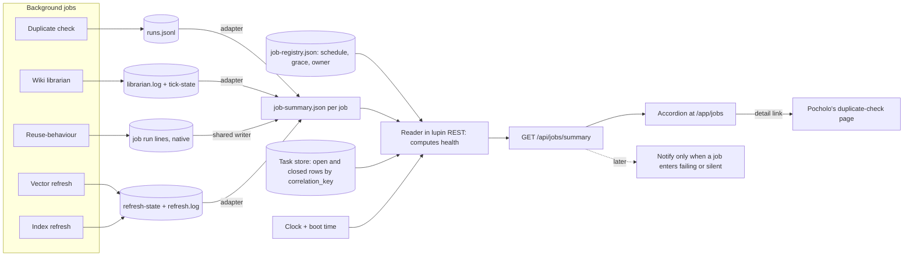

# One reporting format for background jobs, and the accordion that reads it

Rick's words (by voice, 2026-11-07, about 19:40, via row `d2aa0a7b`): the duplicate check's scan and its remediation are both behind, "an accumulating debt, which is utterly unacceptable", and the other background jobs (embeddings, wiki, indices) need the same watching. The deliverable is the **format**. The accordion is its first reader.

## 0. Verdict

- Every job reports **two debts** (work not yet looked at; rows filed and still open) and **two times** (last attempt, last clean run) in one small record. §1.
- A job that did not run is told apart from a job that ran and found nothing by one rule: **every run writes a record, even a clean one, so only a missing record means "did not run"**. The reader, not the job, decides "silent", because a dead job cannot say so. §3.
- Start with five jobs: duplicate check, wiki librarian, reuse-behaviour, vector refresh, symbol-index refresh. §4. Render at a new lupin page `/app/jobs`; build row text in §8.

## 1. The format: two files, two writers

| File | Written by | Holds | Why separate |
|---|---|---|---|
| **Registry** `job-registry.json` (lupin conf, one entry per job) | A person, in a reviewed commit | Name, owner, schedule, grace, which debts apply, where the summary lives | The *promise*. A dead job cannot rewrite its own promise, so the registry is what "missed" is measured against |
| **Summary** `job-summary.json` (in the job's own data folder) | The job itself, at the end of every run, in a `finally` block | What the last run did, both debts, a short history | The *report*. Always rewritten whole, by rename, so a reader never sees half a file |

**There is no `health` field in the summary.** v0 had one. Two parties computing it would disagree, and a job that is dead or hung cannot write "I am dead". Health is computed by the reader (§3).

### 1.1 Summary record, v1

```json
{
  "schema"            : "job-summary/1",
  "job"               : "duplicate-check",
  "written_at"        : "2026-11-07T19:31:02-05:00",
  "last_attempt"      : {
    "started_at"      : "2026-11-07T19:31:02-05:00",
    "finished_at"     : "2026-11-07T19:31:02-05:00",
    "trigger"         : "cron | boot | hand",
    "outcome"         : "clean | carried | failed | skipped",
    "stage"           : "branch_guard",
    "failure"         : "stale_branch",
    "evidence"        : "io/duplicate-check-daily/runs.jsonl:9"
  },
  "last_finished"     : { "started_at": "2026-11-06T19:06:59-05:00", "outcome": "carried", "evidence": "io/duplicate-check-daily/runs.jsonl:8" },
  "consecutive_failures" : 1,
  "work_found_last_run"  : 153,
  "scan_debt"         : {
    "unit"            : "definitions",
    "count"           : 2124,
    "never_checked"   : null,
    "drained_last_run": 304,
    "arrived_last_interval" : null,
    "as_of"           : "2026-11-06T19:26:00-05:00",
    "freshness"       : null,
    "points"          : [ { "at": "2026-11-03T11:12:18-05:00", "count": 1030 }, { "at": "2026-11-06T19:06:59-05:00", "count": 2124 } ]
  },
  "fix_debt"          : {
    "unit"            : "rows",
    "own_mark"        : "job:duplicate-check",
    "unfiled"         : 107,
    "opened_in_run"   : 45,
    "points"          : [ { "at": "2026-11-03T11:12:18-05:00", "opened_total": 28 }, { "at": "2026-11-06T19:06:59-05:00", "opened_total": 73 } ]
  }
}
```

**Rules for the record**

1. **Null means "not reported", never "zero" and never omitted.** The page prints "not reported". A debt that does not apply to a job is declared `false` in the registry (a vector refresh has no remediation rows), and is then not shown at all. These two cases must look different.
2. **`outcome`** has four values. `clean`: ran to the end, nothing left over. `carried`: ran to the end, work left over (the duplicate check's own word). `failed`: did not finish. `skipped`: started, decided nothing was due (`--skip-if-saved`, the run lock). **A skipped run still counts as a run** for §3; it just is not progress.
3. **`last_finished`** is the last attempt whose outcome was `clean` or `carried`. It is the "last clean run" Rick asked for; a run that left work behind but finished still counts.
4. **Debts are counts of things, with a unit.** For refresh jobs the debt is staleness instead of a count: `freshness: { "built_at", "stale_after_hours" }`. **The age is never stored.** It is computed at read time from `built_at`. Receipt for why: `vector-status.json` in the reuse-review `refresh/` folder says `"age_hours": 0.01` and was written 2026-10-25; a stored age is wrong the moment it is saved.
5. **`points`** is at most 14 entries, one per finished run, so the reader can see a trend without opening the ledger.
6. **The open-row count is not in the summary.** A job knows how many rows it *filed*. Only the task store knows how many are still open or closed. The reader fills `open_now` and `closed_in_window` by querying the store with `correlation_key`. §2.2.
7. **`owner` is a named seat, never a role label.** Rows owned by "manager on duty" are invisible (row `c7deca58`). The registry carries the owner; the page refuses to show a job whose owner is not a persona name.
8. **A write failure never fails the job.** The job logs it and moves on; the reader then sees an old `written_at` and says silent.

### 1.2 Registry entry

```json
{
  "job"            : "duplicate-check",
  "title"          : "Duplicate check",
  "owner"          : "cheech",
  "rows"           : [ "350d43c8", "477df9a2", "0d23e394" ],
  "summary_path"   : "io/duplicate-check-daily/job-summary.json",
  "schedule"       : [ { "cron": "0 10 * * *", "mode": "daily" }, { "cron": "7 11 * * *", "mode": "baseline" }, { "after_boot_seconds": 300, "mode": "daily" } ],
  "grace_minutes"  : 30,
  "scan_debt"      : true,
  "fix_debt"       : true,
  "fix_debt_key"   : "job:duplicate-check",
  "detail_link"    : "/app/duplicate-check"
}
```

`schedule: []` means "has no scheduler" and is shown as a badge **unscheduled**, never hidden. No first-five job needs it today. The duplicate check **is** scheduled: `crontab -l` lines 21 to 23 (read 2026-11-07, installed 19:22 per María) are `0 10 * * *` (daily), `7 11 * * *` with `--baseline`, and `@reboot sleep 300`. The catalog's gap 1 ("no scheduler") is out of date. The registry entry above carries the baseline line as `{ "cron": "7 11 * * *", "mode": "baseline" }`; the reader counts only attempts of the matching ledger `mode` toward covering a due time. Tunables (grace, window, growth tolerance) live here and in a defaults block, not as literals in the reader.

## 2. Mapping from the duplicate check's real ledger

Source: `lupin/io/duplicate-check-daily/runs.jsonl`, 9 lines, read 2026-11-07. One line per run; schema_version 1. Status values seen: `failed`, `carried`. The run code also produces `ok` (nothing carried) and, for a held run lock, `skipped`, but that case is printed and **not written** to `runs.jsonl` (`duplicate_check_daily.py:742`). So a refused-by-lock run is invisible to the ledger. The adapter must treat it as a gap (§2.3, item 4).

### 2.1 Field map

| Summary field | From `runs.jsonl` | Rule |
|---|---|---|
| `last_attempt.started_at` | `started_at` of the last line | direct |
| `last_attempt.finished_at` | `started_at + elapsed_seconds` | computed |
| `last_attempt.trigger` | `trigger` | `hand` stays `hand`. The cron value is not yet seen in the ledger (no scheduled run has happened); the writer must emit `cron` or `boot` |
| `last_attempt.outcome` | `status` | `failed`→`failed`, `carried`→`carried`, `ok`→`clean` |
| `last_attempt.stage` / `failure` | `failure` (text before and after the first `:`) | `branch_guard: stale_branch` → stage `branch_guard`, failure `stale_branch`. Earlier lines show `judging: …`, `claude_binary: …` |
| `last_attempt.evidence` | `run_file` plus line number | `runs.jsonl:9` and `2026-11-07-193102-hand.json` |
| `last_finished` | last line with `status` in {`carried`, `ok`} | today: line 8, 2026-11-06 19:06:59 |
| `consecutive_failures` | count of `status == failed` since the last finished line | today: 1 (line 9). Between lines 4 and 8 there were 3 failed lines |
| `work_found_last_run` | `findings` | line 8: 153 |
| `scan_debt.count` | `carried` | **a number in the ledger, but a list in the run's own JSON file**; `runs.jsonl` stores the length. Line 8: 2124. Failed lines have `carried: null`, so the count is carried forward from the last finished line, not zeroed |
| `scan_debt.drained_last_run` | `judged` | line 8: 304 (cap 300). Line 4: 100 (cap 100) |
| `scan_debt.never_checked` | **absent** | Cheech gave 12,269 (DM relayed by María, not checked by me). The ledger has no field for it. Needs a new field from the job |
| `scan_debt.arrived_last_interval` | **absent** | derived, §2.3 |
| `scan_debt.points[]` | `started_at` + `carried` of every finished line | today 2 points: 1030 (11-03 11:12) and 2124 (11-06 19:06) |
| `fix_debt.unfiled` | `queued_for_retry` | line 8: 107 findings waiting to be filed. This is debt that is not even a row yet |
| `fix_debt.opened_in_run` | `filed` | line 8: 45; line 4: 28 |
| `fix_debt.opened_total` (points) | running sum of `filed` | 28 → 73 |
| `fix_debt.correlation_key` | **absent** from the ledger | from the registry. Cheech names `epic:v022-reuse-remediation` |
| open / closed rows | **not in the ledger** | reader asks the store (item 6 of §1.1) |
| `schedule`, `grace` | not a ledger concern | registry |

Fields in `runs.jsonl` the summary does not need: `group_sizes`, `groups`, `findings_by_commit`, `window_start/end`, `commits`, `judge_calls`, `refused`, `unreadable`, `backfilled`, `mode`, `ceiling`, `cap`. They stay in the run file and are linked from the expanded panel by `evidence`.

### 2.2 What the store says today: the job's own rows cannot be picked out yet

Read-only queries on 2026-11-07, `correlation_key="epic:v022-reuse-remediation"`:

| Query | Result |
|---|---|
| default (terminal rows hidden) | 0 visible, 1 withheld in the holding area. Misleading: it hides finished rows |
| `include_terminal=true` | **137 rows**: 136 `done`, 1 `not_approved` |

Of the 137, **none has `created_by` equal to `duplicate-check-daily`**. Every `created_by` is a seat (Cheech under several session ids: 40 + 31 + 19 + 7 + 7 + 4 + 3 + 2 + 2; sam 4; maria 3 + 1; mr radio 2; Krishna 2; chloe 1). The key therefore mixes the job's rows with rows managers filed by hand, and the ledger's 73 filed rows (28 + 45) cannot be told apart from them by key or by creator. Rick dropped the 45 duplicate rows, which is why the default query shows almost nothing.

**Rule adopted: fix debt counts only the job's own rows.** The job must stamp each row it files with a key that is its own (`job:duplicate-check`, or whatever Cheech picks), or with a `created_by` of `duplicate-check-daily`. The reader counts `open_now` and `closed_in_window` on that mark alone, and the registry field `fix_debt_key` holds it. Counting the shared epic key is rejected: it would show other people's work as the job's debt.

**Open point for Cheech:** which mark does the duplicate check put on the rows it files, and does it put one on the 73 already filed? Row `c7deca58` (role-label owners) is the same problem seen from the board. Until settled the page shows `fix_debt.unfiled` (107, from the ledger) and "open rows: not reported". The reader must also ask for terminal rows, or "closed" is always 0.

### 2.3 Gaps the ledger leaves, and how the reader copes

1. **Arrivals are not recorded.** They can be derived: `arrived = count_now − count_before + drained_now`. From lines 4 and 8: 2124 − 1030 + 304 = 1398 definitions over 3.33 days, about **420 a day**. Row `477df9a2` says about 560 a day. The two do not match; I did not settle why (different windows are likely). The job should write `arrived_last_interval` itself so nobody guesses.
2. **Failed lines have no debt.** The reader carries the last known count and marks it `as_of` the run that produced it.
3. **`as_of` for the debt is the finish of the last finished run**, not the time the page loads.
4. **A run refused by the run lock leaves no line.** Add one (`status: skipped`, `note`).
5. **Tonight's line 9 is a re-run of the installer, not a scan.** Its `failure` is `branch_guard: stale_branch` and its run file holds the `--install` command (`2026-11-07-193102-hand.json`). The cron lines were already in since 19:22 (§1.2), so the scheduler is fine; the 19:31 attempt is what failed. The page still shows it as the last attempt, and the job reads **failing** until a scan finishes. Adapter note: an `--install` re-run should not write a scan line at all; otherwise it masks the real `last_finished`.

## 3. Health states and exact rules

The **reader** computes health from: registry, summary, the store counts and the clock. Evaluate top to bottom; the first that is true is the **badge**. Every rule that is true is also listed as a **reason** in the expanded panel, so a job can be failing *and* behind and say both.

| Order | State | Exact rule |
|---|---|---|
| 1 | **unknown** | The summary file is missing, unreadable, or its `schema` is not `job-summary/1`. Shown as "never reported" or "unreadable". |
| 2 | **silent** | `schedule` is not empty **and** a due time exists **and** `now > last_due + grace` **and** no attempt (of any outcome, including `skipped`) has `started_at >= last_due` **and** no live run lock. |
| 3 | **failing** | `last_attempt.outcome == "failed"`. Shows `consecutive_failures` and `last_finished`. Clears at the next `clean` or `carried` run. |
| 4 | **falling behind** | Any one of A to D below. |
| 5 | **healthy** | None of the above. |

**Plus a badge, not a state: `unscheduled`**, when `schedule` is empty. It sits beside whatever state applies. None of the five first jobs carries it today: the duplicate check has its cron lines (§1.2).

**Silent, in full.**
- `last_due` is the latest time not after `now` at which any schedule entry should have started. A cron entry is computed from the cron text. An `after_boot_seconds` entry is `boot_time + seconds`, where boot time comes from the machine (`/proc/stat` `btime`).
- `grace` is `grace_minutes` from the registry; default 30.
- "Covered" means some attempt began at or after `last_due`. A hand run counts, because the question is "did it run", not "who ran it".
- If the machine booted after `last_due` and the boot entry has not yet come due, the job is not yet late (the catch-up line will cover it).
- **Sub-reason on silent:** if the machine's boot time is later than `last_due`, the panel says "missed while the machine was off". This is open question 5 in the explainer, answered with one clause.
- A job still running (lock held, `started_at` in this window, no finish) is **running**, not silent. It turns silent only if the lock is older than 3 × the job's longest recorded `elapsed_seconds`.

**Falling behind: four tests.** Window = the last 7 days of `points`, at least 2 points.
- **A. Scan debt grew.** `scan_debt.count_latest > count_earliest`, and the increase is at least 5 items **and** at least 5 % of the earlier count.
- **B. No drain.** `scan_debt.count > 0` and `drained_last_run == 0` for the last 2 finished runs.
- **C. Fix debt piling up.** Store says `open_now > 0` **and** rows opened in the window exceed rows closed in the window **and** `open_now >= open_at_window_start`. (This is Rick's "a job whose scan is current but whose rows pile up is falling behind too".) If the store count is unavailable, test C is skipped and the panel says "open rows: not reported". It never passes silently.
- **D. Stale.** For a `freshness` debt: `now − built_at > stale_after_hours` (vector refresh: 36 h in its own status file).

**Clears in** = `count / (drain_per_day − arrival_per_day)` if the denominator is positive; otherwise the text **"never at this rate"**. With fewer than 2 points it says "not enough runs". It is a number a person can act on, which is why it is on the collapsed line.

**Quiet versus dead, in three sentences.** A quiet job wrote a record: its `outcome` is `clean` and its `work_found_last_run` is 0, so the line reads "ran 10:17, found nothing". A dead job wrote nothing after `last_due`: its line reads "SILENT, due 10:17, nothing since". The doc-parity tick and hook-link tick print nothing when clean (catalog P3, L9, gap 12), so adopting this format means they must write a record on every run.

## 4. First entries, then the rest

### 4.1 First five, in this order

Order follows Cheech's (duplicate check, wiki librarian, reuse-behaviour) and María's widening (vector refresh, index refreshes).

| # | Job (catalog) | State today, from files I read | Scan debt | Fix debt | Source for a first summary |
|---|---|---|---|---|---|
| 1 | **Duplicate check** (L5) | failing (re-run of the installer refused at 19:31), behind (1030 → 2124); scheduled, 10:00 daily | `carried` 2124; never-checked 12,269 per Cheech | 107 unfiled; filed 73; open: not reported until the job's rows carry their own mark (§2.2) | `runs.jsonl` + adapter. Pocholo's status page is row `0d23e394` |
| 2 | **Wiki librarian** (L1), row `791bf720` | failing: `"ran": false`, "export query failed: 200", 25 such lines in `librarian.log`; last good run date `2026-10-20` in `tick-state.json` (the log's last `"ran": true` is 2026-10-15) | `findings` 526, `deferred` 137 in the state file | rows it created (`created`: 10); five new rows in the holding area under a role label (`c7deca58`) | It already writes `{"ran": …, "reason": …}` per tick: the closest thing to this format. Adapter reads `librarian.log` + `tick-state.json` |
| 3 | **Reuse-behaviour** (L4), row `804838d4` | failing: `weekly.log` holds 8 `REFUSING … LUPIN_CONFIG_MGR_CLI_ARGS is NOT set` lines; last write 2026-11-07 18:00:01 | none (it builds a page) | none | **No ledger at all.** The log has no timestamps, so run times come only from the file's mtime, and failure *counts* are unrecoverable. Needs a native writer (§5) |
| 4 | **Vector refresh** (L2) | healthy: `refresh-state.json` `built_at 2026-11-07T17:16:08Z`, 13,218 rows, 134.9 s | `freshness` (36 h limit) | none | `refresh-state.json` is nearly the summary already; `refresh.log` has the history. `vector-status.json` is stale (2026-10-25) and must not be the source |
| 5 | **Symbol-index refresh** | **unverified.** The catalog lists no scheduler for the index build; vector refresh's reason text "the index changed since the set was built" implies one exists | freshness | none | First task for the build row: find what rebuilds the index and where it records it. Nothing is claimed here |

Not read by me and so not claimed: whether the five already have the cron lines their registry entries would promise. The catalog gives: L1 10:17 and boot +120 s, L2 10:47 and +240 s, L4 18:00 and +360 s, L5 none.

### 4.2 Next, from the catalog's 48 processes, and why

| Next | Why it earns a line |
|---|---|
| **L3 shadow audit** | Feeds L4; has a queue (`shadow-pending`); its log said `audited: 0` for the last run, which a summary would call `clean`, found nothing |
| **P3 doc-parity tick, L9 hook-link tick** | Silent when clean (gap 12). They are the pure test of "quiet versus dead" |
| **P4 worktree report, L6 disk report** | Report-only jobs that keep naming work nobody does (gap 8): their fix debt is the pile they name |
| **L7 hook-log sweep, L8 io/tmp sweep** | Already log counts ("eligible 61,278, reclaimed 61,275"): scan debt is `eligible − reclaimed` |
| **P1 context tick** | Five lines, every 10 minutes; null readings (gap 5). Good silent-detection test at the fastest cadence |
| **L17 epic-board scan, L27 stale scans, P12 nightly deploy** | Unscheduled today (gap 10; the duplicate check no longer belongs here). They would show as `unscheduled` plus silent-by-age, which is the honest picture |
| **L12 worktree janitor** | Acts on a clock inside the arbiter; its removals are a drain figure |

### 4.3 Out of scope, and the reason

Hooks, guards, gates (P5 to P8, L23 to L25, M1): they fire on events, so there is no expected run to miss. Services with their own health view (L11, L13, L14): a loop that is up is already visible elsewhere. M3 (GitHub Actions) reads an outside system; later, as a separate feed, and nothing on the host reads it today (gap 11).

## 5. How a job adopts the format

| Level | What the job does | Used by |
|---|---|---|
| **Adapter** | A small function in the job's repo reads the ledger it already has and writes `job-summary.json` after each run | Duplicate check, wiki librarian, vector refresh |
| **Native** | The job calls a shared writer at the end of every run, from a `finally`, and appends one line per run to its own `runs.jsonl` in the duplicate check's shape | Reuse-behaviour (no ledger today), and every new job |

One shared writer module in `lupin_mcp` (`write_summary( job, attempt, scan_debt, fix_debt )`) so five jobs do not write five variants. A job killed before its `finally` writes nothing, and §3 catches that as silent. That is the design working, not a hole.

## 6. What the accordion shows

**Collapsed, one line per job, always the same columns** (state is colour *and* text; colour alone fails for colour-blind readers):

```
▶ ●  Duplicate check   FAILING · BEHIND                 last run 19:31 failed (stale_branch)   last finished 11-06 19:06   scan 2,124 ▲   unfiled 107 ▲   clears: never at this rate
▶ ●  Wiki librarian    FAILING                          last run 12:12 failed (export 200)     last finished 10-20          scan 526 ?      rows 10 ?       clears: not enough runs
▶ ●  Reuse-behaviour   FAILING                          last run 18:00 refused (config)        last finished: not reported  –               –               –
▶ ●  Vector refresh    healthy                          last run 12:13 built                   last finished 11-07 12:16    age 2 h of 36   –               –
```

Order: worst state first (unknown, silent, failing, behind, healthy), then by name. A header line counts them: "5 jobs: 3 failing, 1 behind, 1 healthy". Nothing on the collapsed line needs the panel to be read.

**Expanded panel:**

| Block | Content |
|---|---|
| Reasons | Every true rule from §3, one line each, in plain words ("scan debt grew 1030 → 2124 in 3.3 days") |
| Last 7 attempts | A strip of outcomes with times; a gap where a run was due and absent is drawn as a hole, not skipped |
| Scan debt | Count, unit, `as_of`, a sparkline from `points`, drained per run, arrivals, never-checked, clears-in |
| Fix debt | Unfiled, filed total, open now, closed in window, sparkline, and the store link for the job's own mark |
| Schedule | Next due time, last due time, grace, the "unscheduled" badge where it applies |
| Evidence | Paths: ledger line, run file, log. Each a doc-viewer link where in scope |
| People | Owner; rows (`350d43c8` and so on) as titled links, not bare ids |
| Not reported | Every null, listed by name, so a missing figure is visible rather than assumed zero |

## 7. Data flow



## 8. Where it renders in lupin, and the build row

Read-only survey of lupin; nothing edited or run there.

- **Page.** `src/cosa/rest/routers/pages.py` maps URL paths to HTML files (`"/app/notifications" : "html/notifications.html"` at line 26, and the `/app/admin/*` pages below it). The accordion is a new entry: `/app/jobs` → `html/jobs.html`.
- **Data.** A new router (beside `arbiter.py` and `tasks.py` in `src/cosa/rest/routers/`) exposes `GET /api/jobs/summary`. It reads the registry and each summary, queries the store, applies §3, and returns finished states. The browser computes nothing, so there is one definition of "silent".
- **Links.** The expanded panel links to Pocholo's per-job status page (row `0d23e394`); the accordion is the index and his page is the detail for the duplicate check.
- **Not Notifications.** Per-job state is a standing view, not an event. Notifications fire only on a transition into failing or silent (once), to follow the attention rule in `docs/explainer/2026.11.04-operator-attention-timeline.md`.
- **Check what runs, not what is on disk.** Merged lupin UI files can sit unserved (`npm run build` for TypeScript, an immutable `?v=` token on legacy scripts). The build row's test must load the served page.

**Text for the lupin build row** (a lupin-resident session builds it; María files it):

> **Title:** [LUPIN] Background-jobs accordion at /app/jobs, reading the job-summary/1 format
> **Body:** Build per `planning-is-prompting/src/rnd/2026.11.07-background-job-reporting-format.md`. (1) Shared writer in `lupin_mcp` plus adapters for the duplicate check (`runs.jsonl`), wiki librarian, vector refresh; native writer for reuse-behaviour. (2) `job-registry.json` and the reader in lupin REST that computes health by the §3 rules, including **silent** from schedule, grace and boot time. (3) `GET /api/jobs/summary` and `/app/jobs` with the collapsed line and expanded panel of §6. (4) Settle with Cheech which mark the duplicate check puts on the rows it files (the shared key `epic:v022-reuse-remediation` holds 137 rows and none is created_by `duplicate-check-daily`); fix debt counts only rows with the job's own mark, and the reader must include terminal rows. (5) Find what rebuilds the symbol index. Done when: tests for each rule in §3 with a fake clock (a job past due is silent; a skipped run is not silent; a failing job that also grows is both), the served page loads and shows the four real jobs above in their real states, and no test touches a GPU. Owner: lupin-resident session; reviewer: Cheech.

## 9. Risks and what this does not cover

- **A job that lies in its own summary** (writes `clean` on a half-done run). The reader cannot tell. Mitigation: `evidence` points at the ledger line, and the registry's `scan_debt: true` jobs must show a plausible count.
- **Clock and cron edge cases.** DST and the cron "day of month or day of week" rule are the usual traps; the reader's tests must include both.
- **Two figures disagree** (420 vs 560 a day, §2.3). The page shows the ledger-derived figure and its derivation; it does not pick the nicer one.
- **Correction history (María, 19:43):** an earlier draft called the duplicate check "unscheduled" and treated the 19:31 line as a failed cron install. Wrong: `crontab -l` lines 21 to 23 carry the job (I read them in `crontab -l` this session), and 19:31 was a later installer re-run.
- **Not verified by me:** that `@reboot` lines exist for the other four jobs (catalog says so, I did not re-read their lines); the 12,269 figure; whether Pocholo's page already defines any of these fields.

## 10. Agreement with Pocholo

Not yet agreed. v0 went to Pocholo from María. v1 changes to review with him:
1. `health` removed from the summary; computed by the reader.
2. `last_run.status` is now `last_attempt.outcome` with `clean | carried | failed | skipped`, and `last_finished` added.
3. Two debts, with `fix_debt.unfiled` (from `queued_for_retry`) separate from open rows.
4. Open and closed row counts come from the store, not the job.
5. `schedule` moved to the registry; `unscheduled` is a badge.

## 11. Questions for Rick

1. **Where should it live?** Recommended: its own page `/app/jobs` (a view you open on purpose). Alternative: a tab on `/app/admin`. A page costs one more bookmark; a tab hides it behind admin.
2. **Should "falling behind" ever ring your phone?** Recommended: no. Paint the line, notify once only when a job turns failing or silent. Ringing on every growing debt would put the duplicate check's backlog in your ear daily until it clears.
3. **Default grace for "silent":** 30 minutes after a due time. Say if daily jobs should be looser.
