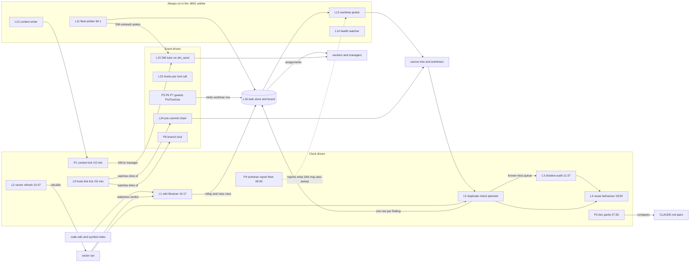

# Live repo process catalog: what keeps lupin, lupin-mobile and planning-is-prompting in step

Paths: `L/` = `/mnt/DATA01/include/www.deepily.ai/projects/lupin/src/`, `P/` = `planning-is-prompting/workflow/scripts/`, `M/` = `lupin-mobile/`, data root `D/` = `/mnt/DATA01/include/www.deepily.ai/projects-data/lupin/reuse-review/`. Read on 2026-11-07 between 13:20 and 14:10 EST (machine clock). Notes behind this document: `io/tmp/catalog/01-pip-and-cron-notes.md`, `02-lupin-notes.md`, `03-lupin-mobile-notes.md`.

## 1. Summary

I found **48 catalog entries**: 15 in planning-is-prompting (which also holds the shared crontab and the global hook layer), 30 in lupin and 3 in lupin-mobile. By trigger: **14 cron-driven** (the crontab has 26 live lines, 4 of them dead one-shots from September and 2 yearly reminders, plus 5 paused lines, plus the duplicate check's lines that do not exist), **8 server or arbiter loops**, **9 hooks** (Claude Code and git), **3 event-driven services** (the DM rewriter, the task store, the failure watchdogs), **13 workflow steps or by-hand tools** and **1 CI system** with 3 GitHub workflows. Most checks work. Four do not: the **duplicate check has no cron line** (planned, row 350d43c8) and runs only by hand with a growing backlog (477df9a2), the **wiki librarian has not finished a clean run since 2026-10-20** (791bf720), **reuse-behaviour refuses to run from cron** for a missing config variable, and **all three lupin-mobile GitHub workflows failed on 2026-11-04**. The counts are my own tally of the tables below; the tables are the source.

## 2. Catalog

Column key: **Trigger** quotes the real crontab, hook config or workflow text. **On today?** is evidence or the word *unverified*. **Failures** cite store rows.

### 2.1 planning-is-prompting (includes the shared crontab and the global hook layer)

| # | Name | Home (file:line) | Reads | Writes / files / sends | Trigger | On today? | Consumer | Known failures |
|---|---|---|---|---|---|---|---|---|
| P1 | Context-pressure tick | `P/context-pressure-tick.sh:37` | `GET /api/arbiter/context-pressure` on :7999 | DM to the worker's manager, notify to Rick, per-persona log | crontab: `0,10,20,30,40,50 * * * * …context-pressure-tick.sh … # slot-mrradio-6be12952`; same line shape for cheech (`1,11,…`), maria (`9,19,…`), sam (`6,16,…`), tiffany (`7,17,…`) | **On.** Logs `/tmp/claude-1001/context-pressure-tick-*.log` written 13:16 to 13:20 today | Managers (re-spin decisions), Rick | Null readings: "not judgeable this tick, null reading: mr radio, Cheech" (maria log 12:19); "manager UNRESOLVED for Cheech … a hand-started seat has no spawn lineage" (13:19). Five more lines `# [PAUSED 2026-09-06 …]` still sit in the crontab |
| P2 | Tick installer | `P/install_context_pressure_tick.py:612` | crontab | Adds the P1 line for this seat, under the crontab lock (`P/crontab_lock.py`) | SessionStart hook in `~/.claude/settings.json` | On (hook configured; the five live P1 lines exist) | P1 | none found |
| P3 | Doc/deploy parity tick | `P/doc-parity-tick.sh:43`, `P/doc_deploy_parity.py` | canonical vs deployed paragraphs (e.g. `global/CLAUDE.md` vs `~/.claude/CLAUDE.md`) | Notify (and optional DM) only on drift; state file | crontab: `30 7 * * * …doc-parity-tick.sh >> ~/.lupin/logs/doc-parity-tick.log` | **On.** syslog CRON line 2026-11-02 07:30; log is 0 bytes, which is its design for "clean". State file `~/.claude/doc-parity-tick-state.json` absent, so no alarm was ever sent | Rick, managers | none found. Result "clean" is *unverified*: zero bytes cannot be told apart from a tick that fails silently, except that exit 1 is supposed to print |
| P4 | Weekly worktree and branch census | `P/worktree_hygiene_report.py:380` | git worktree lists of each repo | Notify, log. Report only | crontab: `0 9 * * 1 … worktree_hygiene_report.py --notify` | **On.** `~/.lupin/logs/worktree-hygiene-report.log` 2026-11-02 09:00 "notify: HTTP 200", lists 18.5-day-old worktree `planning-is-prompting-wt-entry-caps-sent` | Rick, managers | The report has named that worktree since at least 2026-11-02; nothing acts on it (see gap 8) |
| P5 | Memento record guard | `P/memento_record_guard.py:733` | the Write/Edit target path | Refuses a bare Write of a memento record | PreToolUse, matcher `Write\|Edit` in `~/.claude/settings.json` | On (hook configured; ran in this session without blocking) | Every seat | none found |
| P6 | Worktree creation guard | `P/worktree_creation_guard.py:149`, `P/worktree_store_registrar.py` | Bash/Task/Agent commands | Mints a store row (owner + TTL) for an out-of-sandbox worktree, or refuses | PreToolUse, matcher `Bash\|Task\|Agent` | On (configured). Mode (enforcing or not) *unverified* | Janitor (L12), P4 | none found |
| P7 | R&D write guard | `P/rnd_write_guard.py:666` | frontmatter of a `src/rnd` write | Refuses a write with no `authorized_by` | PreToolUse `Write\|Edit` (`--mode pretooluse`) and lupin pre-commit (`--mode precommit`) | On (configured; this document passed it) | Every seat | none found |
| P8 | Branch lock | `P/branch_guard.py:189`, `P/branch-guard-reference-transaction.sh` | ref creations | Refuses new branches from a Claude session; appends `branch-ledger.tsv` | git `reference-transaction` hook in all three repos' `.git/hooks`; plus a Bash PreToolUse check | **On.** Blocked a read-only `git config core.hooksPath` inside a compound command in this session at about 13:12 (false positive) | Every seat | Rows 0a9b1d68 (the rule), 3a592920 (the Bash guard). The guard refuses a read it should allow when it is inside a compound command |
| P9 | Last call / closing time | `P/last_call.py:1110`, `P/closing_job.py`, `P/last_call_window.py` | the declaring store row | Writes two crontab lines (wrap, close); fires a DM/notify to seats | crontab lines tagged `# last-call-93f5a770-wrap` / `-close` (one-shot form) | **Off.** The two lines in the crontab are for 2026-09-29 22:40 and 22:55 (`40 22 29 9 *`, `55 22 29 9 *`); log dir `/tmp/claude-1001/last-call/` does not exist. Same for `maria-wrapup-poke.sh` lines (Sep 22) | Seats, Rick | Dead lines fire again next year on those dates (gap 6) |
| P10 | Session-start ritual | `workflow/session-start.md` (steps 0.5, 3.5, 3.6, 4, 4.5, 4.6, 4.7) | `history.md`, `TODO.md`, `.claude-session.md`, store | Session manifest, tick install, owed-work reconcile | Workflow text: "Read history.md, TODO.md, and implementation document at start of each session" | On when a seat follows it. *Unverified* per session | Seat | none found |
| P11 | Session-end ritual | `workflow/session-end.md` (0.3, 0.35, 0.5, 0.6, 1.6, 1.7, 3.5, 4, 4.7, 5, 6) | git status, store, mementos | History/TODO edits, commit, orphan-row check (`P/orphan_row_check.py:311`), memento sweep (`P/memento_sweep.py:228`), orphaned-head sweep (`P/orphaned_head_sweep.py:368`), LoC summary | Workflow text: "commit without asking, ask only about the push" | On when a seat runs `/plan-session-end`. *Unverified* per session | Rick, next seat | none found |
| P12 | Nightly deploy | `P/nightly_deploy.py:302` | merged work, remote host config | Ships to remote host, files follow-up row on failure | Workflow text session-end §4.7; no cron line | **Not scheduled.** No crontab line or timer found; whether a manager runs it nightly is *unverified* | Remote host | none found |
| P13 | Command-drift check | `P/pip_drift_check.py:600`, `P/pip_manifest.py` | installed commands vs `workflow/MANIFEST.json` hashes | Report | By hand / ritual (no cron) | *Unverified* last run | Installers | Documented: 27 of lupin's 36 installed commands differed from canonical in July (docstring) |
| P14 | Stop-poke switch | `P/stop_poke.py:98` | `~/.claude/settings.json` | Flips `heartbeat.poke_output_enabled` | By hand ("mute"/"restore") | *Unverified* current value | Stop hook (L23) | none found |
| P15 | Backup | `M/src/scripts/backup.sh` pattern; session-end §5 | project tree | rsync copy (`--write`) | By hand, prompted at session end | *Unverified* last run | Rick | none found |

### 2.2 lupin

| # | Name | Home (file:line) | Reads | Writes / files / sends | Trigger | On today? | Consumer | Known failures |
|---|---|---|---|---|---|---|---|---|
| L1 | Wiki-librarian tick (wiki vs code) | `L/cosa/repo/symindex/librarian_tick.py:596` (run at `:327`) | symbol index, `src/docs/wiki`, lupin-mobile wiki, store | Store rows (one rollup per package, one per miss; shared `epic:` key), `misses.jsonl`, `tick-state.json`, `D/librarian/librarian.log` | crontab: `17 10 * * * …librarian_tick` and `@reboot sleep 120 && …` | **On, failing.** INI `wiki librarian tick enabled = true` (`L/conf/lupin-app.ini:2272`). `librarian.log`: "tick could not read rows to export: status 200" on 11-02, 11-03, 11-04, 11-05, 11-06, 11-07 12:12; `tick-state.json` `last_run_date` 2026-10-20 | Workers/managers (rows), reuse reviewer | **791bf720** (export treats 200 as failure). 2026-10-18 "create held … status 422". Rows land in the holding area with role-label owners: **c7deca58** |
| L2 | Vector refresh (embeddings) | `L/cosa/repo/symindex/vector_refresh.py:252` (run `:125`), `L/scripts/reuse-vector-refresh.sh` | symbol index, model-server embeddings service | New vector set swapped in by rename; purpose lines; `refresh-state.json` | crontab: `47 10 * * * …reuse-vector-refresh.sh` and `@reboot sleep 240 && …` | **On, working.** INI `reuse vector refresh enabled = true` (`:2326`); `refresh-state.json`: built 2026-11-07T17:16:08Z, 13218 rows, 58 purposes, 134.9 s | Lookup tools, shadow audit, L1's staleness verdict | none found. `D/refresh/vector-status.json` is dated 2026-10-25 (older than the build); whether that is stale is *unverified* |
| L3 | Reuse shadow audit | `L/scripts/reuse-shadow-audit.sh` (calls `lupin_mcp` reuse modules) | queued lookups, receipts | Audit receipts, `shadow-audit.log` | crontab: `37 11 * * * …` and `@reboot sleep 300 && …` | **On, idle.** Log 2026-11-07 12:14 `{"audited": 0, … "failed": 0}`; INI `reuse shadow audit enabled = true` (`:2335`) | L10 (behaviour page), reviewers | none found |
| L4 | Reuse behaviour page | `L/lupin_mcp/reuse_behaviour.py:431` | call log, `refusals.jsonl`, audit receipts, duplicate-check results | Fleet page (`--write --skip-if-saved`) | crontab: `0 18 * * * … -m lupin_mcp.reuse_behaviour --write --skip-if-saved` and `@reboot sleep 360 && …`. The file says "weekly"; the cron runs daily | **On, failing.** `D/behaviour/weekly.log` 2026-11-07 12:15: "REFUSING: CandidateError: DEPENDENCY_MISSING: no ConfigurationManager in this process: [LUPIN_CONFIG_MGR_CLI_ARGS] is NOT set. Nothing was made." | Rick, managers | No row yet (gap 3) |
| L5 | Daily duplicate check | `L/lupin_mcp/duplicate_check_daily.py:527` (schedule constant `:49`), `duplicate_check_filing.py:154`, `duplicate_check_audit.py`, `duplicate_check_refile.py` | main branch window since `last-success.json`; detached worktree; vector pool; judge model through the Claude CLI | Result JSON, `judge-ledger.jsonl`, `pending-rows.jsonl`, `verdicts.jsonl`, `last-success.json`; one store row per duplicate definition; known-miss entries for L3 | Code constant `CRON_SCHEDULE = "7 12 * * *"` with a reboot line +300 s. **Planned, not installed (row 350d43c8**, which asks for 10:00 every day plus boot catch-up). Live crontab: no `duplicate` line | **Hand runs only.** `lupin/io/duplicate-check-daily/`: all result files end `-hand.json`, latest `2026-11-06-190659-hand.json`; `last-success.json` 2026-11-06T19:06:59-05:00 commit `2713f32d`; `verdicts.jsonl` touched 2026-11-07 12:42. A crontab backup of 2026-11-03 15:17 held two `# duplicate-check-daily` lines; the live crontab has none (who removed them: *unverified*) | Managers (rows), L4, merge gate L28 | **477df9a2** (cap 300 vs about 560 functions a day; 2,124 carried; whole tree never checked). **c7deca58** (one row per finding under a role label; 45 rows in the holding area). **d4fce2bb** (fail fast on a saturated model server). Schedule mismatch: code says 12:07, row 350d43c8 says 10:00 |
| L6 | Disk report | `L/scripts/disk-hygiene-report.sh` | `io/` sizes, worktrees | Report log | crontab: `0 19 * * 0 … disk-hygiene-report.sh` (the comment above it says Sundays 03:00) | **On.** `io/claude_code_hooks/logs/disk-hygiene-report.log` 2026-11-01 19:00: "hook logs over 50k files", "20 fully-merged worktrees reclaimable" | Rick | The comment says 03:00; the line runs 19:00 (gap 7) |
| L7 | Hook-log sweep | `L/scripts/sweep-hook-logs.sh` | per-event hook files older than 14 days | Deletes them | crontab: `30 19 * * 0 … sweep-hook-logs.sh --apply` | **On.** Log 2026-11-01 19:30: eligible 61,278, reclaimed 61,275 files (0.20 GB) | Disk | none found |
| L8 | io/tmp sweep | `L/scripts/sweep-io-tmp.sh` | `io/tmp` ages (older than 10,080 min) | Deletes | crontab: `0 19 * * * … sweep-io-tmp.sh --apply` and `@reboot …` | **On.** Log 2026-11-07 12:09: eligible 0, after 40 files | Disk | Row 730b33f2 (installer). It deletes `io/tmp` files after 7 days: this catalog's notes in `planning-is-prompting/io/tmp/catalog/` are a different repo, so safe |
| L9 | Hook-link tick | `L/scripts/hook-link-tick.sh`, `L/cosa/utils/hook_link_tick.py:250` | `core.hooksPath`, pre-commit / pre-push / reference-transaction links | Notify/DM only on a finding; never repairs | crontab: `2,12,22,32,42,52 * * * * …hook-link-tick.sh` | **On.** syslog CRON 12:12 through 13:22 today; log 0 bytes (clean). Ledger `~/.claude/hook-link-tick-state.json` absent, so never alarmed | Rick | none found |
| L10 | Yearly reminders | `~/.lupin/remind-password-rotation.py`, `remind-lora-pipeline-review.py` | none read | Notification | crontab: `0 22 17 8 *`, `0 21 17 8 *` | Fire once a year on Aug 17. Whether they ran: *unverified* (logs not read) | Rick | none found |
| L11 | Fleet arbiter (heartbeat arbiter) | `L/lupin_arbiter_app/fleet_arbiter_loop.py:1058`, `L/cosa/agents/heartbeat_arbiter/arbiter_job.py` | `~/.claude/heartbeat-events/*.jsonl`, roster, store, commons | Commons topic `fleet-escalations`, DM outreach, pokes, live notify, operator gate digest. Never auto-assigns | Service loop. INI `arbiter poll seconds = 60` (`L/conf/lupin-app.ini:846`); stall poke 720 s; manager-stale 2700 s | **On.** systemd user unit `lupin-arbiter-app`, pid 1482 up since 2026-11-07 12:09:51; journal 13:24:00 `arbiter_poke_gate`; 13:12:39 `arbiter_outreach` and `live_notify_sent` | Managers, Rick | Log noise: `arbiter_hold_reader_cwd_fallback` 430 lines in 15 minutes (journal 13:09 to 13:24) |
| L12 | Worktree janitor | inside `L/cosa/agents/heartbeat_arbiter/arbiter_job.py:1378`, `L/cosa/agents/shared/worktree_reaper.py` | worktrees idle over 6 h in lupin, lupin-mobile, planning-is-prompting | Auto-commits WIP to a rescue branch, removes the directory, never pushes; deletes the branch only if merged | Per arbiter poll. INI `arbiter worktree janitor enabled = True` (`:1000`) | **On.** Journal 2026-11-07 12:11:06 `worktree_janitor_branches` deleted `wt-rescue/seat-cc-author-cheech-1-…`, `-4-…`; also 2026-11-06 22:50:30. 37 such events in 48 h | Seats, disk | It removed cheech seat trees at boot 12:11 while `seat-cc-author-cheech-1/3/4` processes appear at 13:23 in `ps` (made after the 12:11 drain: not a defect, row `414ae689`) |
| L13 | Context-pressure writer | `L/lupin_arbiter_app/context_pressure_writer.py:58` | session context sensors | The :8001 store section read by P1. Sends nothing | Service loop, about once a minute | **On.** Journal `context_pressure_written` 15 times in 15 min, last 13:24:18 | P1 | The null readings in P1 start here (unverified which side) |
| L14 | Health watcher | `L/lupin_arbiter_app/health_watcher.py:48` | Docker health of lupin-model-server, lupin-postgres, rest containers | Notify on a status change | Service loop, INI `arbiter health watch interval seconds = 30` | **On.** Journal `health_obs` 13:24:42, 120 in 15 min | Rick | none found |
| L15 | Outgoing-DM rewriter (DM tutor) | `L/cosa/rest/routers/dm.py:2109` (`_apply_dm_tutor`), `L/cosa/agents/dm_tutor/tutor.py` | the DM body at `dm_send` | Delivers a headline + two sentences + path; falls back to the original on any failure; writes a corpus row | Event: every DM over the trigger length. INI `dm tutor enabled = True` (`:1427`); output gate `False` | **On.** `docker logs lupin-rest-dev` (last 10 min): "[dm-tutor] REFUSED a rewrite that invented facts: {'name': [\"Clayton's\"]}". Uses the LAN vLLM model service, not a direct GPU call | DM recipients | **65073e81**: on the VM the tutor silently fails closed. The rewriter can drop the sender's detail by design |
| L16 | Task store and board | `L/cosa/rest/routers/tasks.py`, `L/cosa/rest/db/repositories/task_repository.py` | rows in lupin-postgres | Rows, transitions, promotion tickets | On request (MCP `task_create`, `task_query`, `task_transition`) | **On** (answered in this session) | Every worker (assignments), arbiter | **c7deca58** (rows owned by a role label nobody reads) |
| L17 | Epic-key drift scan / epic board | `L/scripts/scan-epic-key-drift.py:128` | live board rows | `planning-is-prompting/docs/epic-board.md` | By hand (no cron) | **Stale.** `~/.lupin/logs/epic-board.log` last written 2026-08-28, "27 rows, 10 epics, 3 drifted" | Managers | Not scheduled; last run 10 weeks ago |
| L18 | Notification expiry sweep | `L/cosa/rest/notification_expiry_sweeper.py:34`, `L/lupin_app/lifespan_steps.py:413` | pending response-required notifications | Marks orphans `expired` | Loop; INI `notification expiry sweep enabled = true` (`:1915`), 300 s | Server up (:7999 healthy). This loop's own output: *unverified* | Notification UI | none found |
| L19 | Commons archival | `L/lupin_mcp/commons_archival.py:43` | `io/commons/*.md` | Moves entries older than 24 h to `io/commons/archive/yyyy-mm-dd/` | Loop; INI `commons archival interval seconds = 3600` (`:1345`) | Config on; last run *unverified* | Commons readers | none found |
| L20 | Notify outbox | `L/lupin_mcp/notify_outbox.py:38` | failed notify calls | Re-sends them | Loop; INI `notify outbox enabled = True`, flush 30 s (`:1496`), TTL 24 h | Config on; last flush *unverified* | Rick | none found |
| L21 | Dead-queue and test-suite watchdogs | `L/cosa/rest/watchdogs.py:24`, `dead_queue_watchdog.py`, `test_suite_completion_watchdog.py` | dead queue, done queue | Dispatches an automated fixer job | Event: a job dies or a test suite fails | Wired at server start; last firing *unverified* | Fixer agents | none found |
| L22 | Websocket heartbeat and cleanup; console tee | `L/lupin_app/lifespan_steps.py:386`; `L/cosa/rest/cc_transcript_tailer.py:178` | open sockets; seat transcripts | Pings; drops dead sockets hourly; transcript frames | Loops: 30 s heartbeat, hourly cleanup, per-seat tailer | Server up; per-loop state *unverified* | UI | none found |
| L23 | Claude Code hooks (8) | `L/lupin_cli/claude_code/hooks/{register_session,pre_tool_use,post_tool_use,stop,user_prompt_submit,notification,session_end,permission_request}.py` | hook payload, voice buffer, session bridge | Session bridge file, TTS, buffer drain; Stop hook can block a stop; injects the per-turn TTS reminder | `~/.claude/settings.json` hooks: SessionStart, PreToolUse, PostToolUse, Stop, Notification, UserPromptSubmit, SessionEnd, PermissionRequest (30 s timeout) | **On.** `io/claude_code_hooks/logs/hook-events.jsonl` last event 2026-11-07 13:25 | Every seat, Rick | none found |
| L24 | Pre-commit chain (secret scan, R&D guard, doc-lint with comment and docstring lint) | `L/scripts/pre-commit-chain.sh`; `L/cosa/repo/doc_lint/gate.py:1114`, `comment_lint.py:16`, `docstring_lint.py:85` | staged files | Refuses a commit; counts table `src/conf/doc-lint-counts.json` | git pre-commit (`.git/hooks/pre-commit -> ../../src/scripts/pre-commit-chain.sh`) | **On** (link present; L9 checks it every 10 min) | Committers | Crash exits 0 on purpose (docstring of `gate.py`), so a broken gate lets commits through |
| L25 | Pre-push chain | `L/scripts/pre-push-chain.sh` | pushed refs | Refuses a push | git pre-push | On (link present). Content *unverified* | Pushers | none found |
| L26 | Reuse merge gate | `L/lupin_mcp/reuse_merge_gate.py:279` | lines a branch adds, git window | `refusals.jsonl`; refuses a merge | By hand at merge (manager) | *Unverified* last run | Managers | none found |
| L27 | Stale-process and stale-seat scans, orphan sweep | `L/scripts/stale-process-scan.py`, `stale-seat-scan.py`, `orphan-sweep-tick.sh`, `delivery-collision-scan.py` | process start times vs merges; seat trees | Reports | By hand. No cron, no timer (`systemctl --user list-timers`: 0) | **Not scheduled** | Managers | Their own docstrings say nothing else watches a running daemon against a merge |
| L28 | Side services (bounce watcher, CC memory watch, credential watcher) | `L/scripts/lupin-bounce-watcher.service`, `lupin-cc-memory-watch.service`, `lupin-credential-watcher.service` | host state | Warnings / bounces | systemd unit files in the repo | Installed state *unverified* (not queried) | Rick | none found |
| L29 | Backups | `L/scripts/backup.sh`, `sync-to-backup.sh`, `backup-postgres.sh`, `sync-data-to-backup.sh` | project and data | rsync / pg dump | By hand, session-end step 5 | *Unverified* last run | Rick | none found |
| L30 | Pokes (heartbeat poker agents) | `L/cosa/agents/heartbeat_poker_job.py`, `heartbeat_poker_commons_gateway.py` | recipient list | Wakes sessions | Agentic job on a fixed cadence when started | *Unverified* | Seats | none found |

### 2.3 lupin-mobile (root `lupin-mobile/`; nothing of its own in the crontab)

| # | Name | Home (file:line) | Reads | Writes / sends | Trigger | On today? | Consumer | Known failures |
|---|---|---|---|---|---|---|---|---|
| M1 | Commit gate (doc lint, ignore check, markdown gate, `dart analyze --fatal-infos`) | `M/tool/pre_commit_gate.py`, `M/tool/hooks/pre-commit` | staged Dart and markdown, `M/tool/data/gated_dirs.txt`, baselines | Refuses a commit | git pre-commit; `lupin-mobile/.git/config:6` `hooksPath = tool/hooks` | **On** (config + hook file) | Committers | `--no-verify` skips it; CI is the backstop (`pre_commit_gate.py:26`) |
| M2 | Manager's merge gate | `M/tool/merge_gate.py`, `check_test_failures.py`, `check_ac_g2.py`, `doc_coverage.py` | commit range, `M/tool/data/test_failures_baseline.json` (10-10) | Pass or refuse | By hand, before a merge | *Unverified* last run (no log) | Manager | none found |
| M3 | GitHub workflows | `M/.github/workflows/flutter-ci.yml`, `pr-check.yml`, `release.yml` | the pushed code | Pass/fail, release APK | `on: push` (main, develop, feature/*, release/*), `pull_request`, `push: tags`, `workflow_dispatch` | **On, failing.** `gh run list -R deepily/lupin-mobile`: three FAILURE runs dated 3 days ago | Rick, manager | Flutter CI (main, run 41872521041) and the PR run (41872231781): job Analyze Code, step "Verify formatting", "Process completed with exit code 1". Release Build v0.2.2 (run 41872680000): "automatically failed because it uses a deprecated version of `actions/upload-artifact: v3`" |

Four processes in other repos also act on lupin-mobile: L1 (lints the mobile wiki and files rows for tiffany; broken, 791bf720), L12 (janitor sweeps lupin-mobile), P8 (branch lock in its `.git/hooks`), and the global hooks (L23).

## 3. Interaction map

**Where two processes act on the same thing**

| Same thing | Processes | What happens |
|---|---|---|
| The task store holding area | L1 (wiki rows, owner cheech), L5 (duplicate rows, owner "manager on duty"), P6 (worktree rows), arbiter digest L11 | All file into one board with different owner styles; 50 role-labelled rows were in the holding area on 2026-11-07 (c7deca58) |
| The duplicate-check findings | L5 files rows, L5 also queues L3 audits, L4 reports on both, last-call.md used to run it | Three consumers of one output; the schedule that feeds them is not installed |
| The vector set | L2 rebuilds at 10:47, L1 reads its staleness verdict at 10:17, L5 builds its own vectors in `io/duplicate-check-daily/vectors` | L1 always judges the set that L2 built the day before; L5 keeps a second copy |
| Worktrees | L12 janitor (acts), P4 weekly report (reports), L6 disk report (reports), P6 guard (registers) | Four processes, one acts; the Monday report keeps listing a worktree the janitor leaves alone (18.5 days old on 2026-11-02) |
| Context pressure | L13 writes, P1 reads five times per 10 minutes, L11 also pokes stalled seats | P1's five lines each run the whole-fleet check; the Cheech DM log shows repeat delivery at 13:19 |
| Git hooks | L9 watches the links that L24, L25 and P8 rely on | The watcher sees a broken link; nothing watches the content of the hook it points to |
| Duplicate-check, 'last call' and the doc | `workflow/last-call.md:89` vs the crontab | The doc says "morning cron"; no cron exists (row 350d43c8) |

## 4. Schedule view

### 4.1 Clock-driven, a typical day (machine clock is EST)

| Time | Process |
|---|---|
| every minute | L13 context writer writes; L11 arbiter polls (60 s) |
| every 30 s | L14 health watcher; L20 notify outbox flush; L22 websocket heartbeat |
| every 5 min | L18 notification expiry sweep |
| every 10 min | P1 five context-tick lines at offsets :00 :01 :09 :06 :07 (mr radio, cheech, maria, sam, tiffany); L9 hook-link tick at :02 |
| hourly | L19 commons archival; L22 socket cleanup |
| 07:30 | P3 doc parity tick |
| 09:00 Mondays | P4 worktree hygiene report |
| 10:17 | L1 wiki librarian (run is "due from 10:00") |
| 10:47 | L2 vector refresh |
| 11:37 | L3 shadow audit |
| 12:07 | L5 duplicate check, **planned only** (row 350d43c8 asks for 10:00) |
| 18:00 | L4 reuse behaviour page |
| 19:00 | L8 io/tmp sweep; Sundays also L6 disk report |
| 19:30 Sundays | L7 hook-log sweep |
| at boot | L8 at once; L1 +120 s; L2 +240 s; L3 +300 s; L4 +360 s (all seen in syslog 2026-11-07 12:09:51); L5 +300 s (planned) |
| Aug 17, 21:00 and 22:00 | L10 reminders |
| dead lines | `45 22 22 9 *`, `0 23 22 9 *`, `40 22 29 9 *`, `55 22 29 9 *` |

### 4.2 Event-driven

| Event | What fires |
|---|---|
| Session start | L23 register_session; P2 tick installer; P10 ritual steps |
| Each user prompt | L23 user_prompt_submit (voice buffer, TTS reminder) |
| Each tool call | L23 pre_tool_use and post_tool_use; P5, P6, P7 guards when the matcher fits; the branch-lock check on Bash |
| Permission prompt | L23 permission_request |
| Stop | L23 stop (can block the stop) |
| Notification | L23 notification |
| DM send | L15 DM tutor rewrite |
| Task create or transition | L16 store; arbiter digest |
| Failed job or test suite | L21 watchdogs |
| Worktree creation | P6 guard + registrar |
| Branch ref creation | P8 branch lock |
| Commit | L24 / M1 pre-commit chains; P7 pre-commit mode |
| Push | L25 pre-push chain; P11 push decision |
| Merge | L26, M2 |
| Session end | P11 steps; L23 session_end |
| Push to GitHub, PR, tag | M3 workflows |

## 5. Gaps and collisions

| # | Finding | Evidence |
|---|---|---|
| 1 | The duplicate check has no scheduler on this machine, yet `workflow/last-call.md:85-89` says it runs "from a morning cron, every day the server is on". Backlog grows (2,124 carried; cap 300 against about 560 new functions a day); the code's own default time (12:07) differs from the 10:00 the row asks for | `crontab -l` has no "duplicate" line; `io/duplicate-check-daily/*-hand.json`; rows **350d43c8**, **477df9a2** |
| 2 | The wiki librarian has failed every run for at least 18 days and reports `ran: false`; the five new rows it filed today sit in the holding area | `D/librarian/librarian.log`, `tick-state.json` `last_run_date: 2026-10-20`; row **791bf720** |
| 3 | `reuse-behaviour` fails from cron every time: the cron line does not carry `LUPIN_CONFIG_MGR_CLI_ARGS`, which the duplicate check's own installer does copy (`duplicate_check_daily.py` `CARRIED`). Its name says weekly but it runs daily | `D/behaviour/weekly.log` 2026-11-07 12:15 "DEPENDENCY_MISSING … [LUPIN_CONFIG_MGR_CLI_ARGS] is NOT set. Nothing was made." No row yet |
| 4 | Duplicate-check and wiki rows go to a role label ("manager on duty", "wiki-librarian tick"), one row per finding, so no board shows them | Row **c7deca58**; 45 + 5 rows in the holding area on 2026-11-07 |
| 5 | The context tick has five live lines that each run the whole-fleet check, five paused lines that still sit in the crontab, null readings for some seats and "manager UNRESOLVED" for hand-started seats, so a worker over budget can be unnoticed | `crontab -l`; `/tmp/claude-1001/context-pressure-tick-maria.log` 12:19 and 13:19 |
| 6 | Dead one-shot crontab lines (last call of 2026-09-29, wrap-up pokes of 2026-09-22) remain; they run again on the same dates next year. `/tmp/claude-1001/last-call/` no longer exists | `crontab -l`; `ls /tmp/claude-1001/last-call` fails |
| 7 | Disk-hygiene comment says Sundays 03:00 and 03:30; the lines run Sundays 19:00 and 19:30 | `crontab -l` |
| 8 | Report-only sweepers keep naming work that nobody does: the Monday report listed an 18.5-day-old worktree, the disk report says "20 fully-merged worktrees reclaimable", and the janitor (6 h threshold) has not removed either | `worktree-hygiene-report.log` 2026-11-02; `disk-hygiene-report.log` 2026-11-01 |
| 9 | ~~Janitor removed `seat-cc-author-cheech-1` and `-4` rescue branches at 12:11 while processes in those trees are running at 13:23~~ **Not a defect** (Tiberius, row `414ae689`, 2026-11-07): the trees were emptied at 12:11:01 to 12:11:03, before the first seat process started at 12:11:25, so the trees in use at 13:23 were made after the drain; the janitor already skips a tree with a live process in it | journal `lupin-arbiter-app`; `ps`; row `414ae689` |
| 10 | Several guards are by hand or unscheduled: nightly deploy (P12), stale-process and stale-seat scans (L27), epic board (L17, last run 2026-08-28), merge gates (L26, M2), command-drift check (P13) | no cron line, no timer; `epic-board.log` mtime |
| 11 | All three lupin-mobile GitHub workflows failed on 2026-11-04, and nothing on the host reads CI results. Two failed at "Verify formatting" (exit code 1); the release failed on a retired `upload-artifact@v3` | `gh run view 41872521041`, `41872231781`, `41872680000` (first error lines in 2.3 M3) |
| 12 | The doc-lint gate and the hook-link tick are both silent when healthy, so zero bytes cannot be told from a tick that never ran; the gate's crash path exits 0 | `doc-parity-tick.log` and `hook-link-tick.log` are 0 bytes; `gate.py` docstring ("It exits 0 on its own crash") |
| 13 | Arbiter journal noise: `arbiter_hold_reader_cwd_fallback` 430 lines in 15 minutes | journal 13:09 to 13:24 |
| 14 | The DM tutor fails closed on the test VM with no signal (row 65073e81), and it refused a rewrite today for inventing a name | `lupin-rest-dev` log; `L/conf/lupin-app.ini` comments near line 710 |

## Unverified, with the reason

- Whether P10, P11, P13, P14, P15, L26, L29 and M2 ran recently: they leave no log I could read.
- Per-loop state of L18 to L22: the server is up and healthy, but I did not read per-loop log lines.
- Whether L10 reminders and L28 systemd units are installed: logs and unit state not queried.
- Who removed the duplicate-check cron lines after 2026-11-03 15:17: no log shows it.
- Whether the Cheech seat trees in gap 9 are new trees: settled later by row `414ae689`; they were made after the 12:11 drain, because no seat process existed before 12:11:25.
